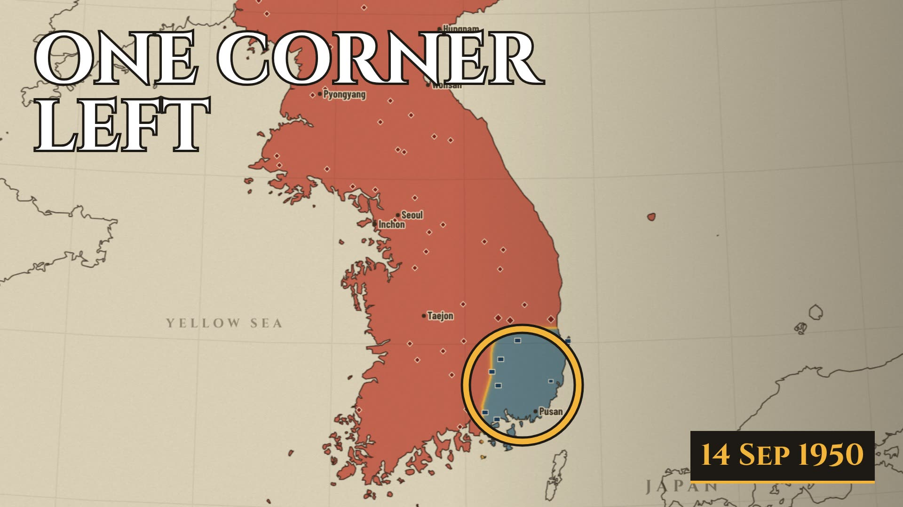
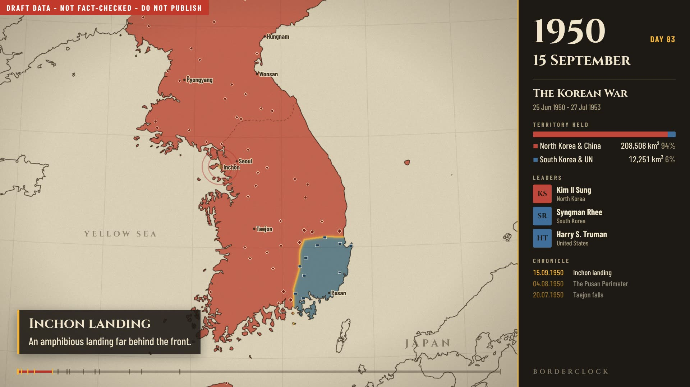
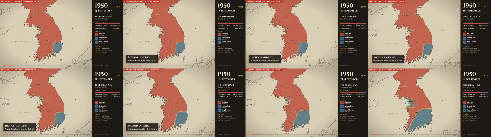

# Map-timelapse history channel: analysis, concept, system, and first 4 videos

Reference: **History on Maps** (`@historyonmaps`). Linked video `N88Y6X6EHjg` = "World War II - Eastern Front
(1941–1945) Every Day" (confirmed via YouTube oEmbed), plus the three uploaded files.

**How to read the evidence labels**

| Label | Meaning |
|---|---|
| **[measured]** | Measured from the three uploaded MP4s: ffprobe, scene-cut detection, loudness and stereo analysis, frames every 6 s, every 1 s for the first 12 s. |
| **[3rd-party]** | From vidIQ and SponsorRadar pages, Oct 2026. They are estimates and only partial lists. |
| **[inference]** | My reading of the evidence. It could be wrong. |
| **[assumption]** | Something about you or the market I had to assume. |

**What I could not access.** youtube.com itself blocked automated requests (Google "unusual traffic" page), so
I have **no** CTR, retention, impressions, upload history, full video list, or comments. I saw one thumbnail
(the linked video's). Everything about their packaging performance is inferred from view counts.

**Your constraints were left blank**, so I assumed **[assumption]**:

- Solo creator.
- Near-zero budget (< $30/month).
- The PC with the RTX 3090 Ti described in `CLAUDE.md`.
- Comfortable running Node/Blender scripts with Claude Code.
- English-language channel.
- Goal: 4 test videos in about 4 weeks.

If any of that is wrong, the plan still holds. Only the tool and asset choices in Steps 7 and 11 would shift.

---

## STEP 1 — Reference channel analysis

### A. Positioning

| | |
|---|---|
| Niche | Military / political history |
| Sub-niche | **Animated map timelapses of wars, "Every Day" format**: one continuous map, the date ticking, fronts moving. Older uploads were broader animated history ("Full History of X in 5 Minutes", "Rise and Fall of…") [3rd-party titles]. |
| Audience [inference] | History buffs, grand-strategy gamers (Hearts of Iron, Total War, Paradox titles), r/MapPorn-type map lovers, students. Probably male-skewed, 18–45, global. The video has no language dependency beyond a few captions. |
| Sophistication | Medium. Viewers already know the war's outcome and many names; they come to *see* it, not to be taught it. |
| Main desire | "Show me the whole war at once": a gestalt view a book or a lecture can't give. Secondary: settling "who was winning when" arguments. |
| Emotional appeal | Awe at scale and speed, tension of a front collapsing, satisfaction of the final map. A hypnotic, ASMR-like quality. |
| Why subscribe | A reliable series: "they'll do *my* war next". Collectability. |
| What's different | Extreme information density, zero narration, short (2–4 min), a recognisable dashboard layout. |

Scale [3rd-party]:

- About **418K subscribers** and **125M total views**.
- **215 videos** since **Jan 2019**.
- About **0.7 uploads/month** recently, with an estimated **~126K average views per recent upload**.

### B. Topics and videos

Views below are [3rd-party] snapshots. Lengths are only known for the three files [measured].

| Video | Topic | Hook | Format | Length | Packaging | Why it could work |
|---|---|---|---|---|---|---|
| WWII – Eastern Front (1941–1945) Every Day | Largest land war in history | None in-video: starts on day 1. The hook is the title promise. | Single map shot, sidebar dashboard, music | 2:10 | Title = keyword + "Every Day" + years; thumbnail = a raw frame | Huge search/browse demand (WWII), giant front movements |
| Six-Day War 1967 & Yom Kippur War 1973 Every Day | Two short wars, one map | Starts 3 weeks *before* the war with caption build-up | Same, plus bottom captions and aircraft icons | 2:00 | Two wars in one title (more keywords) | Very short war, so it can slow to 3–6 s per day: drama per second |
| [Napoleonic Wars] Peninsular War Every Day (1807–1814) | Pre-modern war | None | Same, period portraits | 3:44 | Bracket prefix adds the parent topic | Niche but loyal audience; ~60K views [3rd-party], lower |
| Operation Overlord Every Day (1944) | D-Day to Paris | — | Every Day | ? | Subtitle "D-Day To The Liberation Of Paris" | ~217K [3rd-party]; anniversary timing (Jun 5 upload) |
| WW2 – Battle of France Every Day (1940) | Fall of France | — | Every Day | ? | — | ~167K [3rd-party] |
| Russian Civil War Every Day (1917–1922) | Multi-faction war | — | Every Day | ? | — | ~151K [3rd-party] |
| The Mexican–American War Every Day (1846–1848) | US war, under-covered | — | Every Day | ? | — | **~666K** [3rd-party]: US audience plus few competitors |
| The Biggest Tank Battle in History: Kursk (1943) Every Day 1 minutes using Maps | Single battle | Superlative claim | Every Day, short | ~1 min (title) | Superlative + keyword-stuffed | ~55K in 2.5 days [3rd-party] |
| Full History of Italy in 5 Minutes | Country history | Time-compression promise | Older animated format | ~5 min | "Full History of X in N Minutes" | **~842K**, top lifetime [3rd-party] |
| What Happened to Joseph Stalin's children? | Biography | Curiosity question | Older format | ? | Question title | ~756K [3rd-party] |

Patterns [inference]:

- **Content pillars:**
  - Wars "Every Day" (current core).
  - Country/empire histories compressed in time.
  - Curiosity biography.
- **What outperforms:** WWII and US-centric topics, and topics *under-served* by competitors (Mexican–American War).
  Older Napoleonic/European topics do worse.
- **Evergreen vs trend:** almost entirely evergreen. Anniversaries give small bumps (Overlord on 5 June, American
  Revolution on 4 July).
- **Length:** 2–4 min for "Every Day" [measured for 3]. Publishing is slow: about one every 6 weeks [3rd-party estimate].
  The format is labour-heavy for them.

### C. Title formula

- **Length:** "Every Day" titles run about 35–60 characters.
- **Keyword placement:** the conflict name sits at the very front (search intent).
- **Structure:** a fixed suffix "Every Day" plus years in parentheses. A [Bracket] prefix adds the parent topic.
  "A to B" ("Barbarossa to Berlin") encodes the arc.
- **What's withheld:** the end state of the map. For famous wars everyone knows the outcome, so the curiosity is
  *visual* ("what does it look like?"), not informational.
- **Rarely used:** numbers (except years), questions, contrarian framing, "you won't believe". The older formats
  used "Full History of X in N Minutes" (time compression) and "What happened to…?" (question).
- **Power words:** "Biggest", "Every Day", "Full History", "Rise and Fall".

Reusable formulas for **our** channel (originals, not rewrites):

1. `The [War], Day by Day ([years])`: the search-first workhorse.
2. `Every Front Line of the [War] in [N] Minutes`: the time-compression promise.
3. `How Close [Side] Came to Losing [Place/Everything]`: the near-miss tension.
4. `[N] Days That Redrew [Region]`: number plus consequence.
5. `Why [Border/Line] Is Exactly Where It Is`: a modern-curiosity entry into a historical war.
6. `[Empire] Grew Every Year for [N] Years. Then It Stopped.`: an arc with the ending withheld.
7. `[Battle], Hour by Hour`: granularity novelty.
8. `They Held the Line and Lost Anyway: [War] on a Map`: an emotional paradox.
9. `[Side A] vs [Side B]: Who Held More Ground, Every Day`: the competition frame.
10. `The [War] Map Changed [N] Times. Watch All of Them.`: a count promise.

### D. Thumbnails

From the one thumbnail I could see:

- It is a **frame of the video itself**: date "07 Dec 1941", the casualty counter, the full sidebar.
- No added text, arrows or faces.
- Saturated red/black territory with bright white condensed type.
- Curiosity mechanism: "a dense, data-rich map at a dramatic moment", plus brand recognition (identical look across
  videos).
- Weakness [inference]: at mobile size the sidebar is illegible noise, and there's no single focal point.

**Our thumbnail system** (rendered from the same data, see `channel/src/Thumbnail.tsx`):

1. **One map state at the most dramatic date.** The moment of maximum imbalance or reversal, not the ending.
2. **Zoomed and cropped 16:9** so the contested area fills half the frame.
3. **One focal ring** (gold, with a dark outline) around the place the eye must land.
4. **0–4 words** in the Cinzel display face, white with a heavy dark stroke, placed in the corner *away* from the
   subject. The words state the paradox or stakes, never the title ("ONE CORNER LEFT", "105 DAYS", "IT NEVER MOVED").
5. **Date stamp** in the opposite corner (a gold-on-ink plate). It is the channel's recognisable motif.
6. **Two-colour rule:** at most two faction colours plus the gold accent, on parchment.
7. **Test:** it must be readable at 160×90 px. Use YouTube's Test & Compare with 2–3 variants (date or words
   changed, not style).



### E. Video structure [measured from the 3 files]

| Time | What happens |
|---|---|
| 0:00–0:03 | Day 1 map, all UI already on screen. The clock holds about 3 s on the first date (Eastern Front), then starts. **No title card, no intro, no narration.** |
| 0:03–0:15 | Clock running at full pace (Eastern Front: about 11–20 days/s); fronts start to move. |
| 0:15–end | One continuous shot. Pace is mostly constant. In the Six-Day War it slows dramatically for combat: about **1 day/s** in the run-up, then **3–6 s per day** during 5–10 June, then about 1 day/s for Yom Kippur, then fast-forward through 1974–1979 aftermath in about 20 s. |
| Pattern interrupts | Leader portrait swaps (Dönitz replaces Hitler; Rabin and then Begin), a whole-map switch between two wars, occasional bottom-of-screen text captions, aircraft icons. |
| Open loop | The *only* open loop is "how does the map end?", plus the casualty counters climbing. |
| Ending | The final map, with no outro, CTA or end card visible in the frames I checked. |

There are **0 hard cuts**: ffmpeg scene detection at threshold 0.3 found none in any of the three files.

Generic timeline of the reference format:

| Time | Phase |
|---|---|
| 0:00–0:03 | Establishing frame (the hook is the title promise) |
| 0:03–0:20 | The first big movement (invasion / first offensive) |
| 0:20–75% | Ebb and flow at constant pace |
| last 25% | Collapse / final push, counters peak |
| end | Final map, a few seconds |

### F. Visual language

| Element | Observation |
|---|---|
| Layout [measured] | Map takes about 75% on the left. A right sidebar about 25% wide holds the casualty counter with flags, the conflict title and date range, and "LEADER" portraits with flags. A big date sits at the top-left of the map with the channel name beneath it as a watermark, and the logo sits in a map corner. |
| Map [inference] | A shaded-relief web-map style basemap with roads, road numbers and place labels. Territories are saturated semi-opaque fills (red/black/blue/teal). *Hundreds of small national-flag icons* stand for units, crowded thickly along the front. |
| Motion | Continuous: date, counters, fronts, flags. No camera movement within a war in two of the three; the Six-Day/Yom Kippur video re-frames once. |
| Text | Condensed bold sans (Oswald/Bebas-like). Event captions are small white text with a shadow, only in the Six-Day video. |
| Audio [measured] | Continuous, no gaps over 1 s below −45 dB. Integrated loudness −12.9 to −14.2 LUFS. The stereo side channel is nearly as loud as the full mix, which is inconsistent with a centred voice, so it is **music only, no narration** [inference: I couldn't listen]. |
| Delivery [measured] | 1280×720 at 60 fps, as downloaded. The upload may be higher. |
| Visual rhythm | There is no "shot length". The stimulus is continuous micro-change: at 11 days/s and 60 fps the date changes about every 5 frames, so **something changes every ~0.1 s**, while the *big* change (a new front shape) lands roughly every 5–15 s [estimate]. |

---

## STEP 2 — The underlying formula

| Stage | What it is |
|---|---|
| INPUT | A war (or empire) with a known start and end and *dramatic geographic swings* |
| IDEA | "Show all of it, compressed, in one shot" |
| TITLE | The war's name (search keyword) + time unit + years |
| THUMBNAIL | The map itself at a dramatic moment, i.e. the product shown as-is |
| HOOK | The promise already made by the title; day 1 on screen |
| STORY | Chronology *is* the story; the front line is the protagonist |
| VISUALS | One map, colour = side, the clock, counters |
| EDITING | Pacing via the clock speed (slow at decisive days, fast in stalemates), not cuts |
| PAYOFF | The final map and final counter values |
| CTA | None |

Why it works:

- **Curiosity:** "What does the whole thing look like?" Known outcome, unknown *shape*.
- **Emotion:** watching a front collapse is visceral; counters make cost tangible; the underdog holding is tension.
- **Retention:**
  - The clock is a built-in progress bar: you can't stop until the end date.
  - Constant micro-change gives no dead frames.
  - Short (2–4 min), so the average percentage viewed is high.
- **Information density:** extreme. A 3-minute video carries what a book chapter's maps carry.
- **Storytelling:** implicit. The viewer narrates it to themselves, so it is language-independent and global.
- **Visual:** a consistent template, so the channel is recognisable.
- **Packaging:** search-first titles plus brand-consistent thumbnails. Suggested traffic comes from sitting next to
  other history-map videos.

The weak spots, which are our openings:

- No real hook.
- No explanation of *why* moves happen.
- No sense of progress beyond the date.
- The basemap and flags look generic.
- Accuracy can't be checked by the viewer (no sources shown).
- Slow output (labour-heavy).
- A crowded format: other big channels make "every day" map videos too.

---

## STEP 3 — Our original channel

**Names:**

1. **Borderclock**
2. Frontline Ledger
3. Tidemark Atlas
4. Inkfront
5. The Moving Line
6. Daybook Atlas
7. Map Hourglass
8. Linewatch
9. Engraved Front
10. Chronoline

**Recommended: Borderclock.** It names the mechanic (a clock that moves borders), is short, spellable and
brandable, and doesn't contain "map"/"history" (crowded words). *Check the YouTube handle, the domain and a trademark
search yourself; I can't verify availability.*

- **Positioning:** Borderclock shows wars and empires as a single moving line on a hand-engraved atlas. Every day
  is on the clock, every decisive move is explained in one line, and every number is measured or sourced.
- **Promise:** *A whole war's front line, day by day, in about 3 minutes: accurate, sourced, and beautiful.*
- **Target viewer [assumption]:** 18–45, history/strategy-game fans, map enthusiasts, students. English UI, but the
  visuals are language-neutral.

**Content pillars:**

1. Wars, day by day (core).
2. Empires, year by year (3D globe opener + map).
3. Battles, hour by hour (later).
4. "Why this border is here", where a modern line is explained by the war that drew it (Korea's DMZ, Cyprus,
   Kashmir: handle with care).

**Visual identity** (what makes it *not* a clone):

| Element | Reference | Borderclock |
|---|---|---|
| Basemap | Web-map/relief with roads | **Engraved atlas**: parchment land, verdigris sea, ink coastline *ripples*, dashed borders, no anachronistic modern borders inside the war zone |
| Units | Hundreds of national flags | **Ink stamp markers** (a shape per side), crowding along the front |
| Front | Implicit | **A burning gold front line** |
| Metrics | Casualties | **Territory held in km² and %, measured from the map** (equal-area projection); casualties only when sourced |
| Explanation | Rare captions | **Every key move gets a one-line caption** and enters a running **Chronicle** in the sidebar |
| Progress | Date only | **"DAY 412" counter and a progress bar with event ticks** |
| Opening | Day 1, no hook | **3 s cold open**: title + one hook line over the starting map. Empire videos open on the 3D globe (Blender). |
| Trust | None visible | Sources in the description; a draft banner blocks unchecked data from rendering clean |

**Voice:** no narrator. Personality lives in the captions: dry, precise, one sentence, occasionally wry ("Two more
years of fighting follow."). Music: restrained orchestral/ambient.

- **Length:** 2.5–6 min (test 3 vs 5–6).
- **Schedule:** 1 per week for the 4-week test, then weekly if it passes. Consistency matters less than quality at
  this stage.

---

## STEP 4 — Content system

### Idea generator (yields far more than 100 ideas)

`[Pillar] × [Subject] × [Angle] × [Time unit]`

- **Subjects (seed list):**
  - **Wars:** Korean, Winter, Continuation, Spanish Civil, Russian Civil, Finnish Civil, Greek Civil, Chinese Civil,
    Vietnam, Iran–Iraq, Falklands, Gulf 1991, Balkan Wars 1912–13, Greco-Turkish 1919–22, Polish–Soviet 1920, Chaco,
    Paraguayan, Franco-Prussian, Austro-Prussian, Crimean, Russo-Japanese, Sino-Japanese 1937–45, Burma campaign,
    North Africa 1940–43, Italian campaign, Pacific islands, Mexican Revolution, US Civil War (eastern/western
    theatres), War of 1812, Thirty Years' War, Seven Years' War, Hundred Years' War, Reconquista, Crusades, Punic
    Wars, Alexander's campaigns, Bangladesh 1971, Ethiopian–Eritrean, Nagorno-Karabakh 1988–94, Irish War of
    Independence, Biafra.
  - **Empires:** Mongol, Roman, Umayyad/Abbasid caliphates, Ottoman, Russian expansion, Qing, Mughal, Inca, Aztec,
    Achaemenid, Macedonian, Carolingian, Napoleonic France, British Empire, Spanish Empire, Portuguese Empire,
    Habsburg, Tang, Mali/Songhai, Timurid, Japanese 1931–42, Holy Roman Empire.
  - **Battles:** Gettysburg, Waterloo, Stalingrad, Kursk, Midway, Verdun, the Somme, Cannae, Hastings, Austerlitz,
    Leipzig, Chosin, Dien Bien Phu, Inchon, Antietam, Agincourt, Tannenberg, Market Garden, Bulge, Iwo Jima.
  - **Borders:** DMZ, Cyprus Green Line, Kashmir LoC, the Durand Line, Alsace-Lorraine, Kaliningrad, Transnistria,
    the Oder–Neisse line, Gibraltar, Ceuta/Melilla, the Panama Canal Zone, Hong Kong, Danzig, Fiume, Memel, Saarland,
    South Tyrol, Hatay, Western Sahara, the Sinai.
- **Angles:**
  - Full arc ("day by day").
  - Near-miss ("how close X came").
  - Paradox ("held the line, lost anyway").
  - Count ("the map changed N times").
  - Versus ("who held more ground").
  - Origin ("why this border").
  - Compression ("N years in N minutes").
- **Time unit:** hour / day / week / year.

40 wars × 2 angles alone gives 80; with empires, battles and borders, **>200 ideas**. Use the scoring below to
pick, never the generator alone.

### Scoring model

Each criterion is scored 1–10. Production difficulty and competition are scored *inverted*: 10 = easy / uncrowded.

Weights:

| Criterion | Weight |
|---|---|
| Curiosity | 15 |
| Demand | 20 |
| Emotion | 10 |
| Thumbnail potential | 10 |
| Title potential | 10 |
| Production ease | 15 |
| Evergreen | 10 |
| Low competition | 10 |

Overall = weighted average.

| Idea | Cur | Dem | Emo | Thumb | Title | Ease | Ever | LowComp | **Overall** |
|---|---|---|---|---|---|---|---|---|---|
| Korean War, day by day | 7 | 9 | 7 | 8 | 8 | 7 | 9 | 4 | **7.5** |
| Mongol Empire, year by year | 8 | 8 | 6 | 9 | 8 | 8 | 10 | 5 | **7.8** |
| Winter War, day by day | 8 | 7 | 9 | 8 | 8 | 8 | 9 | 6 | **7.8** |
| Spanish Civil War, day by day | 7 | 8 | 8 | 7 | 7 | 6 | 9 | 5 | **7.2** |
| Gettysburg, hour by hour | 8 | 8 | 8 | 7 | 8 | 4 | 10 | 6 | 7.3 |
| Why the DMZ is where it is | 9 | 7 | 6 | 8 | 9 | 7 | 9 | 6 | 7.6 |
| Chaco War, day by day | 7 | 3 | 6 | 6 | 6 | 7 | 9 | 9 | 6.3 |
| Eastern Front WWII | 6 | 10 | 8 | 7 | 6 | 3 | 10 | 1 | 6.6 |
| Roman Empire, year by year | 6 | 9 | 5 | 7 | 6 | 7 | 10 | 2 | 6.7 |

Scores are my judgement calls [assumption]. Re-score with search volume (YouTube search autocomplete, Google
Trends) and a quick count of how many existing map videos cover the topic, and what views they have.

---

## STEP 5 — The 4 test videos

Each video tests **one** variable against the baseline, same channel identity.

### 1. Korean War, day by day (baseline)

| | |
|---|---|
| Working title | The Korean War, Day by Day (1950–1953) |
| Alternatives | "Every Front Line of the Korean War in 3 Minutes" · "How Close South Korea Came to Disappearing" · "Why the Korean Border Is Exactly Where It Is" |
| Core idea | The front sweeps the whole peninsula twice, then freezes for two years. |
| Why | High demand, the most dramatic map motion of any 20th-century war, a clean two-sided war (easy data), a modern-relevance hook (the DMZ). A demo is already built. |
| Target | US/Korean/global history viewers |
| Hook | Cold open: "The front swept the whole peninsula twice. Then it stopped moving for two years." |
| Structure | Invasion → collapse to Pusan (slow on the perimeter) → Inchon (hold) → push to the Yalu → China enters → back below Seoul → creep back → stalemate fast-forward → armistice line = today's border |
| Duration | About 3:00 |
| Thumbnail | 14 Sep 1950, Pusan pocket ringed, "ONE CORNER LEFT" |
| Assets | Front keyframes (about 20), event list, public-domain music, optional PD portraits |
| Complexity / difficulty | Medium / medium |
| Retention risk | The 1951–53 stalemate (fixed: 40 days/s fast-forward with a caption explaining it) |
| Hypothesis | *Does the Borderclock style + explanation captions hold viewers on a high-demand, competed topic?* |

### 2. The Mongol Empire, year by year (pillar test)

| | |
|---|---|
| Working title | The Mongol Empire, Year by Year (1206–1294) |
| Alternatives | "The Mongol Empire Grew Every Year for 70 Years. Then It Split." · "From One Tribe to Half of Asia: Every Year of the Mongol Empire" · "How Big the Mongol Empire Really Got, Year by Year" |
| Core idea | The fastest land expansion in history, with the km² counter making it visceral. |
| Why | Evergreen, strong thumbnail (a massive red mass), tests the *empire* pillar, and reuses the Blender globe shot already in `blender/`. |
| Hook | 6–8 s 3D globe opener (Karakorum glowing), then cut to the flat atlas: "By 1279 it covered roughly a sixth of the world's land" (verify the number before using it). |
| Structure | Unification (1206) → northern China → Khwarazm → Caucasus/Rus → Europe raid → Baghdad 1258 → split into four khanates (colour split = pattern interrupt) → Yuan conquest of Song 1279 → 1294 |
| Duration | About 3:00 (`clock: "year"`, about 0.5 years/s) |
| Thumbnail | Max extent, ring on Karakorum, "ONE TRIBE" or "70 YEARS" |
| Assets | About 25 yearly polygons (scholarly atlas-based, *contested borders*: show as soft edges), globe clip |
| Complexity / difficulty | Medium / medium (borders of steppe empires are approximate: say so on screen) |
| Retention risk | Little drama between conquests; mitigate with caption cadence every 10–15 s and the khanate split |
| Hypothesis | *Do pre-modern empire timelapses get comparable CTR/AVD to a modern war?* |

### 3. The Winter War, day by day (emotion test)

| | |
|---|---|
| Working title | They Held the Line and Lost Anyway: The Winter War, Day by Day |
| Alternatives | "105 Days: The Winter War on a Map" · "How Finland Stopped the Red Army (1939–1940)" · "The Winter War, Day by Day (1939–1940)" |
| Core idea | An underdog that barely gives ground, then loses about a tenth of its territory at the treaty (verify the share). |
| Why | Cult interest online, a strong emotional arc, short (105 days), so it can slow to about 1.5 s/day. |
| Hook | "For 105 days, the front barely moved. Then the map changed in a single afternoon." |
| Structure | Invasion on all fronts → Mannerheim Line holds → northern encirclements (Suomussalmi/Raate: zoom) → February breakthrough on the Isthmus → Moscow Peace (the ceded area flips in one beat, area counter drops) |
| Duration | About 2:30 |
| Thumbnail | Isthmus zoom, ring on the line, "IT HELD" |
| Assets | About 12 keyframes; Finnish/Soviet orders of battle for markers optional |
| Complexity / difficulty | Low–medium / low–medium |
| Retention risk | **Static front**: carry it with camera moves between theatres, captions, and the clock |
| Hypothesis | *Does an emotional/paradox title + underdog story beat a plain keyword title on CTR?* |

### 4. The Spanish Civil War, day by day (length and audience test)

| | |
|---|---|
| Working title | The Spanish Civil War, Day by Day (1936–1939) |
| Alternatives | "How Spain Split in Two: Every Day of the Civil War" · "The Map of the Spanish Civil War Changed 1,000 Times" · "Every Front Line of the Spanish Civil War" |
| Core idea | A country split in half that is slowly eaten from both sides. |
| Why | High interest in Europe and Latin America; multiple fronts; tests a **longer (5–6 min)** cut and YouTube's translated title/description (Spanish). |
| Hook | "Spain split in two in a single week. It took three years to put it back together, by force." |
| Structure | Coup (two zones) → Madrid holds → north campaign → Teruel → Ebro → Catalonia → Madrid falls |
| Duration | 5:00–6:00 |
| Thumbnail | July 1936 map with two zones, "SPLIT IN 7 DAYS" (verify) |
| Assets | About 30 keyframes (good public maps exist: check licences), music bed long enough or looped |
| Complexity / difficulty | Medium–high / medium |
| Retention risk | Longer runtime; politically charged comments (neutral captions, no faction glorification) |
| Hypothesis | *Does a 5–6 min video keep AVP above 45%, and do translated titles bring Spanish-speaking viewers?* |

---

## STEP 6 — Blueprints

Common to all four, which is the template the code already implements:

- **Visual:**
  - One continuous map shot, 1920×1080, with the sidebar on the right (date, DAY/YEAR counter, title, territory
    bar, leaders, chronicle).
  - The camera moves only on decisive moments; zoom stays ≤1.7.
  - No hard cuts except the optional globe-to-atlas cut in video 2.
- **Captions:**
  - Title in Cinzel 38 px; line in Barlow Condensed 30 px.
  - One sentence, max about 12 words.
  - On screen 4 s (6 s at the finale), each with a ring pulse at the place.
  - Spacing every 8–20 s; never two within 4 s.
- **Audio:**
  - One restrained orchestral/ambient bed, −14 LUFS master, 1 s fade in and 3 s fade out.
  - Optional soft "stamp"/drum hit on chapter events at −18 dB.
  - **Silence moments:** none; instead the *clock holds* (1.5–2 s) on turning points.
- **Pattern interrupts:**
  - Pace changes.
  - Holds.
  - Zoom-ins.
  - Leader swaps.
  - Colour reversal moments.

### Video 1 — Korean War (about 3:00)

| Time | Map / camera | Pace | Caption (what it says) | Audio |
|---|---|---|---|---|
| 0:00–0:03 | Whole peninsula, 38th parallel | Hold | Title + hook line | Music in |
| 0:03–0:25 | Front drops south, Seoul falls (day 4) | 3 d/s | Invasion · Seoul falls · Osan (first US fight) | Bed |
| 0:25–0:40 | Zoom to 1.6 on the south-east | 3 d/s | Taejon falls · **Pusan Perimeter** (hold 1.5 s) | Bed thins |
| 0:40–1:00 | Perimeter holds | 1.2 d/s from 12 Sep | — (tension: little movement) | Low |
| 1:00–1:10 | Pan to Inchon, pocket appears | **Hold 2 s** | **Inchon landing**: "An amphibious landing far behind the front." | Hit |
| 1:10–1:35 | Zoom out; red collapses north | 3 d/s | Seoul retaken · Pyongyang taken / China crosses the Yalu | Lift |
| 1:35–1:50 | UN near the Yalu | 3 d/s | China enters the war (hold) | Darker |
| 1:50–2:15 | Front falls back below Seoul | 3 d/s | Chosin · Hungnam evacuated · Seoul falls again | — |
| 2:15–2:30 | Creep back to about the 38th | 3 d/s | Seoul retaken again · MacArthur relieved | — |
| 2:30–2:50 | **Stalemate fast-forward** | 40 d/s | Talks begin: "Two more years of fighting follow." | Sparse |
| 2:50–3:00 | Final line = DMZ | Hold | **Armistice**: "No peace treaty has followed." | Resolve, fade |

### Video 2 — Mongol Empire (about 3:00, `clock: "year"`)

| Time | Visual | Caption |
|---|---|---|
| 0:00–0:08 | **Blender globe clip** (`header.introClip`): Asia, Karakorum glows, red spreads | Title + hook |
| 0:08–0:30 | Atlas: Mongolia 1206, Western Xia / Jin attacks | Temüjin becomes Chinggis Khan (1206) · Zhongdu taken (1215) |
| 0:30–1:00 | Westward jump to Khwarazm, wide zoom-out | Khwarazmian Empire falls (1219–21) |
| 1:00–1:30 | Rus' campaign, raid into Poland/Hungary | Kiev falls (1240) · Mohi/Legnica (1241) · Retreat after Ögedei's death |
| 1:30–2:00 | Middle East; slow at 1258 (hold) | Baghdad sacked (1258) · Ain Jalut (1260): first major defeat |
| 2:00–2:30 | **Colour split into 4 khanates** (factions change) | The empire divides (c. 1260) |
| 2:30–3:00 | Song conquest; hold on max extent | Yuan completes the conquest of China (1279) · Kublai dies (1294) |

Audio: drums plus throat-singing-flavoured ambient (only if properly licensed), building to 1258.

### Video 3 — Winter War (about 2:30)

| Time | Visual | Pace | Caption |
|---|---|---|---|
| 0:00–0:03 | Finland whole, Soviet border | Hold | Title + "For 105 days the front barely moved…" |
| 0:03–0:25 | Attacks on all fronts | 1.5 d/s | Soviet invasion (30 Nov 1939) · Helsinki bombed |
| 0:25–0:55 | Zoom to the Isthmus: the line holds | 1.5 d/s | Mannerheim Line holds |
| 0:55–1:25 | Zoom north: Suomussalmi, Raate Road pockets | 1 d/s | Encirclements (verify dates) |
| 1:25–2:00 | Back to the Isthmus; February breakthrough | 1.5 d/s | Soviet breakthrough · Viipuri threatened |
| 2:00–2:20 | **Treaty**: ceded area flips red in one beat | Hold 2 s | Moscow Peace: area counter drops (verify the %) |
| 2:20–2:30 | Final map | Hold | "They held the line, and lost the land anyway." |

Audio: sparse strings, wind SFX bed (CC0); a single low hit at the treaty.

### Video 4 — Spanish Civil War (about 5:30)

| Time | Visual | Pace | Caption |
|---|---|---|---|
| 0:00–0:04 | Spain, two zones appear | Hold | Hook |
| 0:04–0:45 | Coup, zones consolidate, march on Madrid | 3 d/s | Coup (17–18 Jul 1936) · Army of Africa crosses |
| 0:45–1:20 | Zoom Madrid | 1.5 d/s | Madrid holds (Nov 1936) · Jarama · Guadalajara |
| 1:20–2:10 | North campaign | 3 d/s | Guernica bombed (26 Apr 1937) · Bilbao · Santander · Asturias |
| 2:10–2:50 | Teruel | 2 d/s | Teruel taken and retaken |
| 2:50–3:40 | Drive to the sea splits the Republic | 3 d/s | Nationalists reach the Mediterranean (Apr 1938): **the Republic is cut in two** (hold) |
| 3:40–4:30 | Ebro | 2 d/s | Battle of the Ebro |
| 4:30–5:15 | Catalonia falls | 4 d/s | Barcelona falls (Jan 1939) |
| 5:15–5:30 | Madrid falls, end | Hold | War ends (1 Apr 1939) |

Audio: Spanish-guitar-free (avoid cliché); restrained strings; pace the music to the 3:40 midpoint lift.

All dates in these tables are from general knowledge and **must be checked against sources before production**.

---

## STEP 7 — Production stack (decision)

| Need | Choice | Why |
|---|---|---|
| Map timelapse (95% of every video) | **Remotion + canvas map engine (built)** | Data-driven; one JSON = one video; deterministic; renders headless |
| 3D globe openers | **Blender scripts (already in `blender/`)** | Remotion's 3D is weaker; Blender gives real lighting; output an MP4 into `header.introClip` |
| Audio loudness | **FFmpeg `loudnorm`** (to add) | Hits −14 LUFS exactly |
| Thumbnails | **Remotion `Still` (built)** + optional GIMP/Photopea touch-up | Same data and style, 2–3 variants in minutes |
| Narration | **None** for the test | Saves cost and keeps it language-neutral; if tested later: local Kokoro/Piper TTS (free) or ElevenLabs (paid: ask first) |
| Research/drafting | Claude | Event lists, caption drafts, keyframe *first drafts*; all human-checked |
| Premiere / After Effects / CapCut / Resolve / stock APIs / AI video | **Not needed** | Nothing in this format benefits from them |

Remotion licence: free for individuals and small companies (≤3 people); check remotion.dev/license if that changes.

Where Remotion is *not* the right tool: photoreal/3D (use Blender), terrain flyovers (Blender with a DEM), and hand-drawn
artistic maps (a one-off illustration in Krita/Inkscape used as a basemap image).

### Architecture (built in `channel/`)

```
channel/
  data/videos/<id>.json        one file per video (the only thing you edit per video)
  public/geo/                  Natural Earth land/countries (world-atlas, 10m and 50m)
  public/fonts/                Cinzel, Barlow Condensed (OFL)
  public/music, sfx, portraits (you add; licensed)
  src/schema.ts                zod schema = the video JSON spec (validated at load)
  src/videos.ts                registry: each JSON -> video + "-thumb" still
  src/lib/time.ts              clock engine: dates <-> frames, pace segments, holds
  src/lib/sdf.ts               exact distance transform (front morphing)
  src/lib/map.ts               map engine: projection, engraved base, territory state, area, markers
  src/lib/camera.ts            date-keyed camera, clamped view transform
  src/components/MapView.tsx   canvas renderer: base, washes, front glow, markers, labels, pulses
  src/components/Sidebar.tsx   date/DAY counter, title, territory bar, series counters, leaders, chronicle
  src/components/Overlays.tsx  cold-open title card, event captions, progress bar, draft banner
  src/Timelapse.tsx            the video composition (+ music, voiceover, event SFX)
  src/Thumbnail.tsx            the thumbnail still
  scripts/render.mjs           render MP4 + thumbnail + description with chapters; --qc stills per event
```

How each system works:

- **Timeline:** dates drive everything. `timeline.daysPerSecond` sets the base pace; `pace[]` overrides stretches;
  `events[].holdSeconds` freezes the clock. Camera keys, captions, pulses, chapters and leader changes are all
  pinned to dates, so changing the pace never desyncs anything.
- **Maps:** each territory keyframe is a list of *layers* painted in order (`everywhere`, `countries`, `geometry`,
  or `beyond` a front line). Later layers take pixels from earlier ones, so pockets are just a small last layer.
  Shapes are clipped to land and to the `theatre` countries, so you only draw the front line precisely.
- **Morphing:** each keyframe becomes a signed distance field per faction. Frames interpolate the fields, so
  borders slide smoothly and pockets grow and shrink naturally.
- **Measurements:** area is counted per faction from the rendered pixels (exact in an equal-area projection). The
  demo gives 220,760 km² for the two Koreas vs about 220,750 km² real.
- **Captions, progress, transitions:** data-driven from `events[]`. There are no transitions by design: one shot.
- **Charts:** the territory bar and `series` counters (e.g. sourced casualties, linearly interpolated).
- **Audio:**
  - `audio.music[]` is looped with fades.
  - `audio.voiceover` (optional) ducks the music.
  - `events[].sfx` is placed at event frames.
- **B-roll / images:** only portraits (`leaders[].image`) and an optional intro clip. The format doesn't want B-roll.

## STEP 8 — Video data schema

The authoritative spec is `channel/src/schema.ts` (validated with zod). Abridged:

```jsonc
{
  "id": "korean-war",                     // file and composition id
  "draft": false,                         // true = red "not fact-checked" banner on every frame
  "header": { "title": "...", "subtitle": "25 Jun 1950 - 27 Jul 1953",
              "hook": "one line for the cold open", "watermark": "Borderclock",
              "introClip": "clips/globe.mp4" },
  "map": { "projection": "conicEqualArea", "bounds": [[123.5, 33], [131.5, 43.2]],
           "theatre": ["South Korea", "North Korea"],
           "labels": [{ "text": "Seoul", "at": [126.98, 37.57], "kind": "city" }] },
  "factions": [{ "id": "north", "name": "North Korea & China", "color": "#c0473b", "marker": "diamond" }],
  "territories": [
    { "date": "1950-09-16", "note": "source: CMH map 7",
      "layers": [ { "faction": "north", "everywhere": true },
                  { "faction": "south", "geometry": { "type": "Polygon", "coordinates": [...] } } ] },
    { "date": "1950-10-20",
      "layers": [ { "faction": "south", "everywhere": true },
                  { "faction": "north", "beyond": { "side": "north", "line": [[120, 39.4], [125.5, 39.5], [134, 41.5]] } } ] }
  ],
  "timeline": { "start": "1950-06-25", "end": "1953-07-27", "clock": "day",
                "introSeconds": 3, "outroSeconds": 8, "daysPerSecond": 3,
                "pace": [{ "from": "1951-07-10", "to": "1953-07-27", "daysPerSecond": 40 }] },
  "camera": [{ "date": "1950-08-12", "center": [128.3, 36.2], "zoom": 1.6 }],
  "events": [{ "date": "1950-09-15", "title": "Inchon landing", "text": "...", "at": [126.6, 37.47],
               "holdSeconds": 2, "captionSeconds": 4, "chapter": true, "sfx": "sfx/hit.wav",
               "source": "citation for the fact-check pass" }],
  "counters": [{ "kind": "area", "label": "Territory held" },
               { "kind": "series", "label": "Casualties", "source": "...",
                 "rows": [{ "factionId": "north", "points": [["1950-06-25", 0], ["1953-07-27", 0]] }] }],
  "leaders": [{ "factionId": "south", "name": "Harry S. Truman", "role": "United States",
                "image": "portraits/truman.jpg", "to": "1953-01-20" }],
  "audio": { "music": [{ "src": "music/bed.mp3", "volume": 0.6 }], "voiceover": null, "eventSfxVolume": 0.5 },
  "thumbnail": { "date": "1950-09-14", "text": "One corner left", "textAt": "top-left",
                 "highlight": [128.85, 35.5], "zoom": 1.25, "center": [127.8, 37.0] }
}
```

Requested features and where they live:

| Requested | Where it lives |
|---|---|
| Voiceover | `audio.voiceover` |
| Scenes | `events` + `pace`. The format is one scene; holds and camera keys play the role of scenes. |
| Images | `leaders[].image` |
| Video clips | `header.introClip` |
| Captions | `events[].title/text` |
| Music / SFX | `audio`, `events[].sfx` |
| Text | `header`, `labels` |
| Animations | Built in (morph, pulses, caption slide) |
| Transitions | None by design |
| Charts | `counters` |
| Maps | `map` + `territories` |
| Timing | `timeline` + dates everywhere |

## STEP 9 — Components

```
<Timelapse video>                      composition
  <MapView>                            canvas: engraved base, washes (multiply), front glow, markers, labels, pulses
  <EventCaption> <ProgressBar>         lower-third + progress with event ticks
  <TitleCard> | <OffthreadVideo introClip>
  <Sidebar>                            clock, DAY/YEAR counter, title, territory bar, series counters, leaders, chronicle
  <DraftBanner> <Audio music/voiceover/sfx>
<Thumbnail video>                      same MapView at thumbnail.date + words + ring + date plate
```

Build order:

1. Clock + schema
2. Map engine
3. MapView
4. Sidebar
5. Captions/progress
6. Render script
7. Thumbnail

All seven are **done and tested** in this repo. The demo renders. Next to build: loudness normalisation, an
intro-clip test with the Blender globe, and a keyframe-authoring helper (see Step 14).




## STEP 10 — Pipeline

| Stage | Tool | Input → Output | Automation | Human review |
|---|---|---|---|---|
| Idea | Scoring table (Step 4), YouTube search autocomplete, Google Trends | Seed list → ranked topic | Low | Yes: pick |
| Research | Claude + books/official histories (US Army CMH, national archives, scholarly atlases) | Topic → dated event list + front descriptions with citations | Medium | **Yes** |
| Script (= captions) | Claude draft | Events → 12–20 one-line captions + hook | High | Yes: tone, neutrality |
| Fact check | You, sources open | `events[].source`, `territories[].note` | Low | **Yes, mandatory**; flip `draft` to false only after |
| Voice | None | — | — | — |
| Keyframes | geojson.io / QGIS (free), traced from PD/licensed reference maps; or Claude drafts the `beyond` lines from coordinates, then you correct | Maps → 12–30 keyframes in JSON | Medium | **Yes**: QC stills |
| Assets | YouTube Audio Library, Wikimedia Commons (PD portraits) | → `public/` | Low | Licence check |
| Scene JSON | Editor + zod validation | → `data/videos/<id>.json` | High | Remotion Studio scrub |
| Render | `node scripts/render.mjs <id>` | JSON → MP4, thumbnail, description + chapters | **Full** | Watch once |
| Audio mix | In Remotion; `loudnorm` to add | → −14 LUFS | High | Listen on phone |
| Thumbnail | `<id>-thumb` still; 2–3 variants | → JPG | High | Mobile-size check |
| QC | `--qc` stills + checklist (Step 12) | → go/no-go | Medium | Yes |
| Upload | YouTube Studio (manual) | MP4 + description → scheduled | Low | Yes |

Don't automate upload yet. API uploads from unverified Google Cloud projects are forced to private until the
project passes an audit, and manual upload takes 10 minutes.

## STEP 11 — Assets (legal and sustainable)

| Asset | Source | Notes |
|---|---|---|
| Map geometry | **Natural Earth** (public domain) via `world-atlas` (ISC). Included. | Modern coastlines and borders only |
| Historical fronts and borders | Traced *facts* from **US Army Center of Military History** maps and **West Point atlas** maps (US government works, generally public domain), Library of Congress (check each), Wikimedia Commons (check each licence; CC BY-SA means attribute) | Copy the *facts* (where the front was), never the artwork. Cite in the description. |
| Historical basemap datasets | e.g. *historical-basemaps* (GitHub), CShapes | Check each licence before use; some are copyleft or non-commercial |
| Portraits | Wikimedia Commons public-domain photos (many are US government or pre-1929); or initials badges (built in) | Check each file's licence page |
| Music | **YouTube Audio Library** (free, no Content ID risk) for the test; later Epidemic Sound / Artlist (paid: ask first) | Avoid random "free" music, a common Content ID claim source |
| SFX | YouTube Audio Library, freesound.org (**CC0 filter only**), Pixabay | Keep a licence log |
| Fonts | Google Fonts (OFL): Cinzel, Barlow Condensed (included) | |
| Icons/markers | Drawn programmatically (built in) | No flag images needed |
| Stock video / screenshots | **Don't use** | Not part of the format; screenshots of others' maps are copyright risk |

AI vs sourced vs programmatic:

- **Programmatic:** everything visual.
- **Sourced:** facts, portraits, music.
- **AI:** research summaries, caption drafts, title/thumbnail-word brainstorms, keyframe first drafts.
- **No AI imagery.** Trust and accuracy are the brand.

## STEP 12 — QC checklist (per video)

**Script / captions**

- [ ] Cold-open hook states stakes or a paradox in ≤ 15 words
- [ ] No intro beyond 3 s; clock running by 0:04
- [ ] Every caption ≤ 12 words, says *why* or *what it cost*, not just "X happened"
- [ ] Open loops: the hook question is answered at the end; the progress bar shows the remaining ticks
- [ ] No two captions within 4 s; no 20 s stretch without one (except deliberate holds)
- [ ] Neutral wording; contested facts flagged ("approx.", "est.")
- [ ] Every event has `source`; every keyframe has a `note`; `draft: false` only after the check

**Visual**

- [ ] `--qc` stills reviewed against the reference maps
- [ ] No front "teleports" (add a keyframe if a move looks wrong)
- [ ] No anachronistic labels or borders
- [ ] Text readable on a phone (caption ≥ 30 px at 1080p; check at 50% zoom)
- [ ] Camera zoom ≤ 1.7, moves slow (≥ 2 s)
- [ ] Final map held ≥ 5 s for the end screen

**Audio**

- [ ] −14 LUFS integrated, true peak ≤ −1 dBTP
- [ ] Music fades in and out; no hard loop seam
- [ ] SFX not louder than the music bed
- [ ] Licence log complete

**Packaging**

- [ ] Title ≤ 60 characters, keyword in the first 30
- [ ] Thumbnail readable at 160×90; one focal point; ≤ 4 words; text doesn't repeat the title
- [ ] Title + thumbnail make *one* curiosity loop (title = topic, thumbnail = the moment)

**YouTube**

- [ ] Description: one-line promise, chapters (auto-generated), sources, music credit
- [ ] Tags: the war name and 2–3 variants only
- [ ] End screen (last 8 s): next video + subscribe
- [ ] Playlist: "Wars, Day by Day" / "Empires, Year by Year"
- [ ] Pinned comment: "Which war next?" (collects topic demand)
- [ ] Translated title/description (video 4 test)

## STEP 13 — Testing strategy

The question: *does this format have enough audience potential to justify more videos?*

Measure each video at **7 days** and **28 days**, and the set at 28 days after video 4.

| Metric | How to read it |
|---|---|
| **Impressions** | Is YouTube willing to test you? Growing impressions after day 3 means the algorithm found an audience. Flat and tiny means packaging or topic isn't getting picked. |
| **Impressions CTR** | Packaging quality *for the audience YouTube chose*. YouTube says most videos sit between 2% and 10%. For a new channel, ≥ 4% on ≥ 1,000 impressions is encouraging [rule of thumb]. Compare videos, not to big channels. |
| **Average view duration / % viewed** | Does the content deliver on the click? For 2–3 min videos, aim for ≥ 50% viewed; for 5–6 min, ≥ 40% [rule of thumb]. |
| **First-30-second retention** | Hook and title–thumbnail match. A drop over 35% in the first 30 s means the cold open or the promise is off. |
| **Retention-graph shape** | Bumps = rewatched moments (make more of those); cliffs = boring stretches (pace up). The best diagnostic for *this* format. |
| **Returning viewers** | Series appeal. Any returning viewers in a 4-video test is a good sign. |
| **Subscribers per 1,000 views** | Over about 5 is a healthy sign of a "series" feel [rule of thumb]. |
| **Views per impression** | CTR × completeness of the funnel; use to compare the 4 videos. |
| **Traffic sources** | **Suggested** from other history-map videos = the algorithm sees you as a substitute (the main growth path for this format). **Search** = evergreen value. **Browse** = home-feed appeal. |

Decision rule (my suggestion):

- **Continue** if, by day 28, at least 2 of 4 videos show impressions still rising, CTR ≥ 4%, average % viewed above
  the targets, and suggested traffic is the top source.
- **Pivot packaging** if retention is good but CTR is poor.
- **Pivot the format** if CTR is fine but retention is poor.

Do **not** conclude from 4 videos:

- That a *topic* or *pillar* is bad. One video per pillar can't separate topic from packaging, timing or luck.
- Anything from CTR on fewer than about 1,000 impressions, or from the first 48 hours.
- That narration or Shorts would or wouldn't work (not tested).
- That the channel failed because it didn't go viral. New channels often get delayed pickup; evergreen videos
  accumulate.
- Subscriber totals (too few to mean anything), or comparisons with History on Maps' numbers.

## STEP 14 — Execution plan

**Week 1**

| Day | Work |
|---|---|
| 1 | Check name/handle availability; create the channel (banner = a Remotion still of the atlas); on the PC: `cd channel && npm i && npm run studio`, scrub the demo. |
| 2 | Korean War research: event list with sources (CMH *Korea 1950* / *Korea 1951–1953*, PD); pick about 20 keyframe dates. |
| 3 | Redraw Korean keyframes properly against the reference maps; `--qc` stills; fix; add music from the Audio Library. |
| 4 | Final render, `loudnorm`, 3 thumbnail variants; upload video 1 (schedule); pinned comment. |
| 5 | Mongol research (years, extents, contested borders); render the Blender globe opener as `public/clips/mongol-globe.mp4`. |
| 6 | Mongol keyframes (about 25, yearly), captions, QC. |
| 7 | Render video 2 (schedule for week 2). Check video 1's first-72-h retention graph; note cliffs. |

Weeks 2–4: Winter War (week 2), Spanish Civil War (week 3), publish weekly, and review at day 28 after video 4.

**Build first**

1. ✅ Data-driven Remotion timelapse engine, schema, render script with chapters, QC stills and thumbnail (done).
2. Loudness normalisation step (`ffmpeg -af loudnorm=I=-14:TP=-1`) in `render.mjs`.
3. A keyframe-authoring helper: export a keyframe to GeoJSON for editing in geojson.io and import it back; a
   Studio date scrubber.

**Do NOT build yet**

1. TTS narration or voice pipeline.
2. YouTube API auto-upload or analytics dashboards.
3. Vertical Shorts template, dubbing, AI imagery, stock-footage APIs.

**First 4 videos**

1. The Korean War, Day by Day (1950–1953)
2. The Mongol Empire, Year by Year (1206–1294)
3. They Held the Line and Lost Anyway: The Winter War, Day by Day
4. The Spanish Civil War, Day by Day (1936–1939)

**Recommended stack:**

- Remotion 4 (React/TypeScript), with the canvas map engine in this repo.
- Blender for globe openers.
- FFmpeg for loudness.
- Claude Code for research drafts and JSON.
- geojson.io or QGIS for tracing fronts.
- YouTube Audio Library for music.
- YouTube Studio for upload.

Cost: $0/month.

**Estimated production time per video** [estimate]:

| Step | Hours |
|---|---|
| Research | 3–5 |
| Keyframes | 3–6 (the bottleneck) |
| Captions/events | 1 |
| QC loop | 1–2 |
| Packaging | 1 |
| Upload | 0.5 |
| **Total** | **10–15 hours for the first; 6–9 once practised** |

Rendering is unattended: about 0.9 s/frame measured on a 4-core cloud VM, so a 3-minute video is about 80 min
there. Expect much less on the 3090 Ti PC; measure and note it in `CLAUDE.md`.

**Biggest risks**

1. **Crowded format**: other established channels already make "every day" map videos. The differentiation
   (atlas style, explanations, measured area, progress UI) may not be enough for browse traffic. The test answers
   exactly this.
2. **Accuracy**: a wrong front line gets torn apart in comments. Keyframe research is the real cost; the draft
   banner and QC stills are the guardrails.
3. **Sensitive topics** (Korea, Spain, Israel, Kashmir): neutral captions, no glorification, no graphic imagery
   (also keeps ads suitable).
4. **Music claims** (use the Audio Library), and YouTube's policy against mass-produced or repetitive content
   when monetising. Each video needs genuine research and editorial captions, not just a template swap.

**Biggest opportunity**

The marginal cost of a video is now mostly research. The template, rendering, thumbnail and chapters are
automated, so Borderclock can cover the **long tail** of wars, empires and borders that slower channels never get
to (the Mexican–American War result suggests under-served topics can outperform). The engine also gives every
video a *measured* number (territory held), a format competitors can't easily copy.

---

## Status (production log)

| Video | Data | Length | Music | Notes |
|---|---|---|---|---|
| The Korean War, Day by Day (1950–1953) | `channel/tools/build_korean_war.py`: 37 front keyframes from the US Army CMH histories (Appleman; Mossman) and the Natural Earth line of control | 3:25 | Uprising by Scott Buckley (CC BY 4.0) | Flag units: DPRK; PRC from 19 Oct 1950 (most from 25 Nov); ROK; US from 1 Jul 1950; UK and UN from 29 Aug 1950 |
| The Mongol Empire, Year by Year (1206–1294) | `channel/tools/build_mongol_empire.py`: 20 yearly extents checked against Taagepera's areas | 3:12 | Ride The Wind by Scott Buckley (CC BY 4.0, from 0:20) | Army banners only where borders are moving |

Both share:
- An atlas style with a globe cold open, the sidebar dashboard and an end card.
- Audio loudness-normalised to −14 LUFS.
- A description generated with chapters, sources and the music credit.

Render with `node scripts/render.mjs <id>`.
