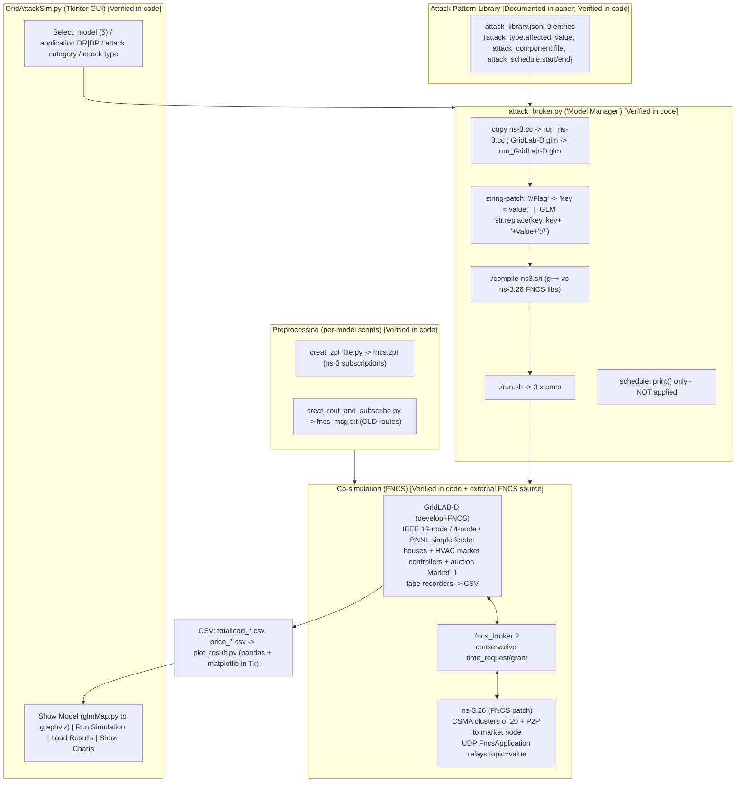
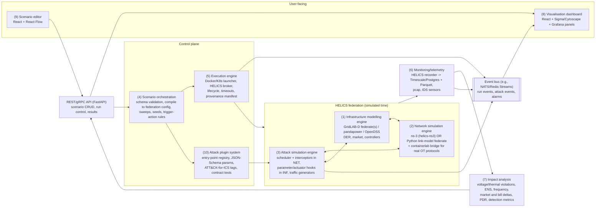
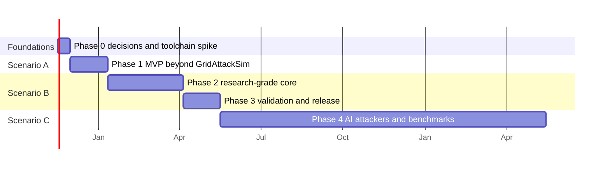

# Rebuilding GridAttackSim takes months, not days

GridAttackSim was a small piece of software produced during a PhD. Tan Duy Le wrote it in Razvan Beuran's JAIST lab between 2018 and 2021, co-supervised from Deakin. It is about **1,059 lines of Python** wrapped around PNNL's 2017-era FNCS tutorial stack: GridLAB-D, an FNCS-patched ns-3.26, and the FNCS broker. Its nine "attacks" are **static text substitutions made in the GridLAB-D model file or the ns-3 C++ source before the run starts**. The headline "attack schedule" is printed to the console but **never applied by the released code** ([repo](https://github.com/crond-jaist/GridAttackSim); [paper PDF](https://www.jaist.ac.jp/~razvan/publications/gridattacksim_framework.pdf)).

The research programme behind it was bounded. No paper after December 2022 links Le with Anwar, Loke or Yasuo Tan. Beuran's lab moved on to cyber ranges for reinforcement-learning agents (PenGym, CMARL-ACD), LLM and cyber-threat-intelligence tooling (RAF-AG), and smart-building emulation (SBCSE). None of these tools put the physics, real attacks and agents back together.

Beating GridAttackSim's *released* capabilities is therefore a low bar. My estimate is that Claude Code, with one engineer supervising, could do it in **about 3–8 weeks of calendar time, 80–250 Claude agent-hours and 40–100 human hours**. A *validated, publishable* research-grade platform is a different job: **about 4–7 months, 480–1,160 agent-hours and 210–490 human hours, of which 70–150 hours come from a power engineer and an ICS security specialist**. An advanced platform with AI attackers and detector benchmarks would take **about 9–18 months**.

Writing code is not what limits any of these. Three things do. The first is native integration: the official HELICS–ns-3 module still targets ns-3.35 while ns-3 is at 3.49, and opendnp3 has been archived since 2022. The second is the absence of a ready-made oracle for "physically correct". The third is research judgement. Anthropic's 16-agent C-compiler build shows the same pattern: it worked because a human built the test harness and used GCC as ground truth ([Anthropic](https://www.anthropic.com/engineering/building-c-compiler)). The most valuable contribution available in 2026 is closing a loop that none of the systems found in this research closes: threat intelligence → LLM or RL attacker → co-simulated grid and network twin → physical-impact score → detector benchmark.

**Evidence labels used throughout.**
- **[Documented in paper]**: stated in the Electronics 2020 article.
- **[Documented in thesis]**: stated in Le's March 2021 JAIST dissertation ([JAIST DSpace](https://dspace02.jaist.ac.jp/dspace/bitstream/10119/17476/12/paper.pdf)).
- **[Verified in code]**: observed in a cloned repository.
- **[Inferred]**: an interpretation made by the research team or by me.
- **[Estimate]**: an effort or cost figure I produced, with its assumptions stated.

**Source-access limits** recorded during research:
- mdpi.com returned HTTP 403 for the article's HTML, PDF and XML. The published PDF was read from Beuran's JAIST mirror instead.
- DBLP served an anti-bot challenge. OpenAlex's free daily budget was exhausted. Google Scholar was not queried.
- The GitHub REST API was blocked, so stars and commit dates come from org pages and `git clone`.
- ScienceDirect returned 403 for the PenGym and SBCSE journal full texts.
- Le's university staff page returned 503.
- The icSmartGrid 2019 precursor paper's full text could not be obtained.

Publication lists therefore rest mainly on ORCID, Crossref and Beuran's self-maintained publications page, and may be incomplete.

---

## 1. Five authors, one doctorate: who built GridAttackSim and where they went

### Tan Duy Le: the builder who left the field

Le (ORCID [0000-0001-6597-0209](https://orcid.org/0000-0001-6597-0209)) holds a B.E. from the University of Information Technology, VNU-HCM (2016), an M.Sc. from JAIST (2018), and a PhD in Information Science from JAIST (March 2021). His ORCID bio also describes him as a "part-time HDR student at Deakin University". His dissertation, *Smart Grid Cybersecurity Experimentation: Architecture and Methodology*, was supervised by Razvan Beuran ([JAIST abstract](https://dspace.jaist.ac.jp/dspace/bitstream/10119/17476/11/abstract.pdf)). A search snippet places Seng Loke on the committee and dates the degree to 24 March 2021 ([JAIST summary](https://dspace02.jaist.ac.jp/dspace/bitstream/10119/17476/3/summary.pdf)).

**Since May 2021 he has been a Lecturer in the School of Computer Science and Engineering at International University (VNU-HCM)** ([ORCID](https://orcid.org/0000-0001-6597-0209); [Crossref RIVF 2022](https://doi.org/10.1109/RIVF55975.2022.10013873)).

His security output is short:
- icSmartGrid 2019 ([doi](https://doi.org/10.1109/icSmartGrid48354.2019.8990712))
- GridAttackSim, 2020 ([doi](https://doi.org/10.3390/electronics9081218))
- a CVSS/graphical-security-model chapter, SGIoT 2020 ([doi](https://doi.org/10.1007/978-3-030-69514-9_11))
- GridAttackAnalyzer in *Sensors*, 2022 ([doi](https://doi.org/10.3390/s22134795))
- a RIVF 2022 countermeasures paper ([doi](https://doi.org/10.1109/RIVF55975.2022.10013873))
- a SoICT 2023 paper on ML-based anomalous-packet detection in smart homes ([doi](https://doi.org/10.1145/3628797.3628930))

His latest work (2025–2026) is entirely applied AI and AIoT. Examples include PPO-LSTM traffic-signal control ([doi](https://doi.org/10.1142/S219688882650020X)), LLM task allocation for elderly care, CARTA ([doi](https://doi.org/10.1142/S2196888826400026)), graph-convolutional multi-agent RL for smart homes ([doi](https://doi.org/10.1080/01691864.2026.2707053)), and shrimp-farming IoT chapters ([ORCID](https://orcid.org/0000-0001-6597-0209)). His only released software is GridAttackSim and GridAttackAnalyzer, both under Beuran's `crond-jaist` organisation. No personal GitHub account was found. [Inferred] He is no longer an active ICS or cyber-range researcher.

### Adnan Anwar: the false-data-injection anchor who kept working on the grid

Anwar is an Associate Professor in Deakin's School of IT and a core member of the Deakin Cyber Research and Innovation Centre. Some 2024 papers list his affiliation as CREST instead. He holds a PhD and a Master by Research from UNSW (at ADFA) and has worked at NICTA/Data61, La Trobe and Deakin. He self-reports an h-index of 40 and more than 150 publications ([Deakin Experts](https://experts.deakin.edu.au/50139-adnan-anwar/about); [ORCID](https://orcid.org/0000-0003-3916-1381)).

**He supplied the attack-physics expertise that GridAttackSim's attack library drew on.** His earlier work covers false-data-injection (FDI) attacks on state estimation (2014–2017), for example stealthy FDI on SCADA/EMS in JCSS 2017 ([doi](https://doi.org/10.1016/j.jcss.2016.04.005)) and OPF data integrity in IEEE TII 2017 ([doi](https://doi.org/10.1109/TII.2017.2740324)). After GridAttackSim he wrote:
- FDI surveys in RSER 2022 ([doi](https://doi.org/10.1016/j.rser.2022.112423)), FGCS 2023 ([doi](https://doi.org/10.1016/j.future.2022.10.021)) and ACM Computing Surveys 2023 ([doi](https://doi.org/10.1145/3592797))
- an IEC 61850 GOOSE vulnerability analysis ([doi](https://doi.org/10.3390/s21041554))
- an IIoT testbed and datasets paper ([doi](https://doi.org/10.1109/SMARTGENCON56628.2022.10083609))
- the Deakin microgrid digital twin ([doi](https://doi.org/10.1109/APPEEC53445.2022.10072197))

His most recent work includes federated wind-power forecasting in IEEE Transactions on Smart Grid (March 2026, [doi](https://doi.org/10.1109/TSG.2025.3620848)), RL-driven CAN-bus fuzzing in IEEE OJVT 2026 ([doi](https://doi.org/10.1109/OJVT.2026.3659052)), integrity attacks in federated IoT (IoT, August 2026, [doi](https://doi.org/10.3390/iot7030068)), and learning-based stealthy load-redistribution attacks for market price manipulation at PESGM 2026 ([doi](https://doi.org/10.1109/PESGM58988.2026.11693770)).

He has released no public software or dataset URL. His collaborators are Deakin colleagues such as Reda, Varghese, Mekala and Mahmood. Whether he supervised them is [Inferred], not confirmed.

### Seng W. Loke: systems co-supervisor, not a security specialist

Loke has been Professor of Computer Science at Deakin since January 2017. He co-directs Deakin's Platforms and Applications Lab, is a member of the ARC College of Experts, and earned his PhD at Melbourne in 1998. His listed interests are IoT, smart cities, cooperative vehicles, edge computing and quantum internet computing. **No security role is listed** ([Deakin Experts](https://experts.deakin.edu.au/40150-Seng-Loke); [ORCID](https://orcid.org/0000-0002-5339-9305)).

Outside the GridAttack papers, his security work is a misbehaviour-detection line for cooperative intelligent transport systems with Robin Doss and Amanullah: an ACM Computing Surveys 2023 review ([doi](https://doi.org/10.1145/3596598)), IntelliMD at a CCS workshop in 2024 ([doi](https://doi.org/10.1145/3690134.3694817)) and Coop-IntelliMD in IEEE Access 2026 ([doi](https://doi.org/10.1109/ACCESS.2025.3638793)). His latest papers include a survey of quantum-secured microgrids (IEEE Systems Journal, March 2026, [doi](https://doi.org/10.1109/JSYST.2026.3652000)). He wrote a Wiley book on quantum internet computing. [Inferred] His role on GridAttackSim was most plausibly Deakin-side co-supervision. His ORCID lists only 52 works, so it is incomplete.

### Razvan Beuran: the lab that carried on

Beuran has been an Associate Professor at JAIST since 2022. He runs the **Cybersecurity Research Lab** in the Next-Generation Digital Infrastructure (NGDI) area, which publishes code under `cyb3rlab`. Before that he worked at CERN, then on StarBED wireless emulation at NICT (2006–2015), then as a JAIST research associate professor (2015–2022) ([CV](https://www.jaist.ac.jp/~razvan/cv.html); [lab page](https://www.jaist.ac.jp/is/labs/beuran-lab/index.html)). His earlier code lives under `crond-jaist`, the GitHub organisation of the NEC-endowed CROND chair. That chair **"ceased to exist in March 2021"**, the same month GridAttackSim's code was released and Le's thesis was filed ([crond-jaist/cyris](https://github.com/crond-jaist/cyris)).

Released software, all permissively licensed:
- CyRIS, CyTrONE, CyLMS and CyPROM
- IoTrain-Sim/Lab and CyATP
- GridAttackSim and GridAttackAnalyzer
- AutoPentest-DRL, the lab's most-starred repository at 448 stars
- PenGym, RAF-AG, CyLLM-DAP, SBCSE, CodeEnhancer, LLMSafeguardEval-NonNL and CMARL-ACD (MIT)

Sources: [crond-jaist](https://github.com/orgs/crond-jaist/repositories); [cyb3rlab](https://github.com/orgs/cyb3rlab/repositories).

His latest publications (page last modified 2026-11-03, [publications](https://www.jaist.ac.jp/~razvan/publications.html)) are:
- SBCSE in *IJCIP* 53:100852, July 2026 ([doi](https://doi.org/10.1016/j.ijcip.2026.100852))
- CodeEnhancer in *Knowledge-Based Systems* 342, 2026
- PenGym and RAF-AG, both in *Computers & Security* 148, January 2025
- the book *Cybersecurity Education and Training* (Springer, 2025, [link](https://link.springer.com/book/9789819605545))
- three late-2026 papers in press: a voice-anonymisation attack (WIFS), JaiLENS jailbreak classification (AICompS) and the AIBNArena demo (AIxNET)

He also won the ICISSP 2025 Best Student Paper award for CyLLM-DAP.

### Yasuo Tan: senior partner on smart homes and smart grids

Tan is a Professor who heads JAIST's Laboratory on IoT and Smart Systems. His research areas include smart grid, smart house, ECHONET Lite and ITU-T standardisation (J.190, Y.2070), and his lab developed an open-source smart-house and smart-community simulator ([JAIST](https://jaist.ac.jp/english/laboratory/ngdi/tan.html)). A snippet from the ECHONET Consortium lists him as advisory fellow and as JAIST Vice President ([ECHONET](https://echonet.jp/?p=70)). Whether he still held that post in 2026 is unverified.

He has co-authored Beuran's work from the QOMET/StarBED era through CyRIS, CyTrONE, CyPROM, AutoPentest-DRL, GridAttackSim and RAF-AG, up to the 2026 SBCSE and CodeEnhancer journal papers ([publications](https://www.jaist.ac.jp/~razvan/publications.html)). He appears in no git log ([Inferred] he is a senior co-author, not a developer). His own 2025–2026 first-author list could not be retrieved, because DBLP and Scholar were inaccessible.

### How the collaboration was wired

[Inferred] JAIST supplied the PhD home, the cyber-range and training framing, and long-term code hosting. Deakin supplied smart-grid FDI expertise (Anwar) and systems co-supervision (Loke), through Le's part-time HDR status. No document confirming a dual degree or cotutelle was found.

The Deakin connection continues today only through Robin Doss. He co-authored GridAttackAnalyzer and now works with Loke on C-ITS security and with Anwar on CAN-bus fuzzing.

---

## 2. Publication timeline: six joint papers in four years, then divergence

| Year | Output | Authors (of the five) | Type / venue | Software | Source |
|---|---|---|---|---|---|
| 2018 | Missing-data imputation for healthcare | Le, Beuran, Tan | KSE 2018 conf. | – | [doi](https://doi.org/10.1109/KSE.2018.8573344) |
| Dec 2019 | Smart Grid Co-Simulation Tools: Review and Cybersecurity Case Study | Le, Anwar, Beuran, Loke | icSmartGrid 2019 conf. (pages cited as 273–280 in paper, 39–45 elsewhere) | none released | [doi](https://doi.org/10.1109/icSmartGrid48354.2019.8990712) |
| Jul 2020 | **GridAttackSim** | all five | *Electronics* 9(8):1218 | released Mar 2021 | [MDPI](https://www.mdpi.com/2079-9292/9/8/1218) |
| 2020/21 | CVSS-based attack analysis with graphical security model | all five + Ge, Duy, Hoang | SGIoT 2020, LNICST | precursor of Analyzer | [doi](https://doi.org/10.1007/978-3-030-69514-9_11) |
| 2020 | Smart Grid Security: Attack Modeling from a CPS Perspective | Beuran, Tan (+ B. Luo) | ComComAp 2020 | – | [Beuran pubs](https://www.jaist.ac.jp/~razvan/publications.html) |
| Mar 2021 | PhD thesis, *Smart Grid Cybersecurity Experimentation* | Le (sup. Beuran) | JAIST dissertation | GridAttackSim and GridAttackAnalyzer pushed to GitHub (first commits 2021-03-05 and 2021-03-12) | [JAIST](https://dspace02.jaist.ac.jp/dspace/bitstream/10119/17476/12/paper.pdf) |
| Feb 2022 | Last code commits (licence text) to both GridAttack repos | – | – | frozen since | [repo](https://github.com/crond-jaist/GridAttackSim) |
| Jun 2022 | **GridAttackAnalyzer** | all five + Ge, Doss | *Sensors* 22(13):4795 | crond-jaist/GridAttackAnalyzer | [doi](https://doi.org/10.3390/s22134795) |
| Dec 2022 | Smart Grid Cyber-Attack Analysis and Countermeasures | Le, Beuran (+ H.P.T. Nguyen, Huynh) | RIVF 2022 | – | [doi](https://doi.org/10.1109/RIVF55975.2022.10013873) |
| 2023 | ML anomaly-packet detection for smart homes | Le (IU) | SoICT 2023 | – | [doi](https://doi.org/10.1145/3628797.3628930) |
| 2024 | SBCSE (conference) | Beuran | PRDC 2024 | cyb3rlab/SBCSE (2025–26) | [PDF](https://www.jaist.ac.jp/~razvan/publications/smart_building_control_system_emulation.pdf) |
| 2024/25 | PenGym (ICISSP 2024; *C&S* 148, Jan 2025) | Beuran | conf. + journal | cyb3rlab/PenGym | [doi](https://doi.org/10.1016/j.cose.2024.104140) |
| 2025 | RAF-AG | Beuran, Tan | *C&S* 148:104125 | cyb3rlab/RAF-AG | [Beuran pubs](https://www.jaist.ac.jp/~razvan/publications.html) |
| 2026 | SBCSE (journal) | Beuran, Tan | *IJCIP* 53:100852 | cyb3rlab/SBCSE | [doi](https://doi.org/10.1016/j.ijcip.2026.100852) |
| 2026 | CMARL-ACD | Beuran | *C&S*, under review | cyb3rlab/CMARL-ACD | [repo](https://github.com/cyb3rlab/CMARL-ACD) |
| 2026 | Market-manipulation attacks via load redistribution | Anwar | PESGM 2026 | – | [doi](https://doi.org/10.1109/PESGM58988.2026.11693770) |
| 2026 | Coop-IntelliMD | Loke | IEEE Access | – | [doi](https://doi.org/10.1109/ACCESS.2025.3638793) |

---

## 3. The programme peaked at physics-plus-toy-attacks, then split into three lines that never reconverged

GridAttackSim makes sense only alongside Beuran's long-running methodological thread: **building realistic, reproducible experimental environments**. That thread runs from wireless-network emulation on NICT's StarBED (QOMET/QOMB, 2006–2015) to YAML-driven cyber ranges under the NEC-endowed CROND chair (CyRIS 2016, CyTrONE 2017, CyPROM 2019) ([CV](https://www.jaist.ac.jp/~razvan/cv.html); [publications](https://www.jaist.ac.jp/~razvan/publications.html)).

Le's doctorate (enrolment around 2018, inferred from student number s1820035; degree March 2021) brought that thread into contact with Anwar's FDI and power-system expertise. The resulting work was bounded by the doctorate. The user's framing of "2018–2022" is accurate if it covers the publication tail. The degree itself ended in March 2021, and the last joint paper appeared in December 2022.

**Phase 1 (2019): a review and a tool choice.** The icSmartGrid 2019 paper surveyed co-simulation tools. It ran fake-data-injection and jamming case studies on the IEEE 13-node feeder with GridLAB-D, FNCS and ns-3, using one model and two attack types, with no GUI and no scheduler ([Deakin DRO](https://dro.deakin.edu.au/articles/conference_contribution/Smart_Grid_Co-Simulation_Tools_Review_and_Cybersecurity_Case_Study/20712694); [paper PDF §2](https://www.jaist.ac.jp/~razvan/publications/gridattacksim_framework.pdf)).

The group chose FNCS even though its own Table 1 lists HELICS (2019). [Inferred] The reason was practical: PNNL's FNCS tutorial (`demo-gld-ns3`) supplied a working GridLAB-D-plus-ns-3 transactive-market demo. One of GridAttackSim's model directories still ships that tutorial's README verbatim ([repo](https://github.com/crond-jaist/GridAttackSim/tree/master/Database/1_Node_255_Houses)).

**Phase 2 (2020): packaging into a framework.** GridAttackSim added four things on top of the demo:
- a JSON "attack pattern library" (type, target and schedule, following Tundis et al. 2017)
- an attack taxonomy based on ENISA, with nine attacks in four groups
- more feeders
- a Tkinter GUI

It then reported two case studies ([paper](https://www.jaist.ac.jp/~razvan/publications/gridattacksim_framework.pdf)). [Inferred] The co-simulation core did not change. The contribution was workflow and packaging, which matches the dissertation's system-usability (SUS) study: 10 PhD students, mean score 74.3 ([thesis](https://dspace02.jaist.ac.jp/dspace/bitstream/10119/17476/12/paper.pdf)).

**Phase 3 (2020–2022): dropping physics in favour of analysis.** The SGIoT 2020 chapter and *Sensors* 2022 GridAttackAnalyzer took the opposite approach. They contain no simulator, only HARM attack graphs and attack trees over CVSS v2 data. GLM files are parsed for topology, but GridLAB-D is never run ([PMC](https://pmc.ncbi.nlm.nih.gov/articles/PMC9268941/); [repo](https://github.com/crond-jaist/GridAttackAnalyzer)). The paper itself argues that building a real smart-grid system for experimentation "would be challenging".

RIVF 2022 then presented the two tools as one "general smart grid cybersecurity architecture implemented in two systems" ([PDF](https://www.jaist.ac.jp/~razvan/publications/smart_grid_attack_analysis_countermeasures.pdf)). [Inferred] The obvious next step was never taken: feed Analyzer's attack paths into Sim's co-simulation to compute physical impact.

**The break (2021–2022).** Three events fell within months of each other. CROND closed in March 2021, the code was pushed to GitHub that same month, and Le joined International University in May 2021. The final commit to both repos, on 2022-02-15, only changed licence text ([repo](https://github.com/crond-jaist/GridAttackSim); [ORCID](https://orcid.org/0000-0001-6597-0209)). [Inferred] The release was a wrap-up act, not the start of a maintained platform.

Repository "updated" timestamps disagree between sources: the org page shows February 2023, while a GitHub search showed September 2026. Neither reflects code commits.

**After the break, the programme split into three lines.**
- **JAIST, IT side.** Beuran's lab pursued the agent thread. AutoPentest-DRL (2020) planned DRL attack paths on MulVAL graphs. PenGym (2024–2025) made the real cyber range the training environment. CMARL-ACD (2026) trains attacker and defender agents together, then tests the policies, without retraining, on a real KVM testbed with the Snort intrusion detection system (IDS) ([PenGym](https://github.com/cyb3rlab/PenGym); [CMARL-ACD](https://github.com/cyb3rlab/CMARL-ACD)). The lab added CTI→ATT&CK path generation (RAF-AG) and LLM security work.
- **JAIST, CPS side.** The CPS-testbed thread returned in SBCSE (2024–2026), a protocol-level MQTT emulation of a real building's control plane. It adds fuzzing and Maude formal verification, but its MITM attack is a state machine that "assumes success" ([SBCSE](https://github.com/cyb3rlab/SBCSE)).
- **Deakin.** Anwar continued grid-physics attacks (FDI surveys, market manipulation) without building a public tool. Loke moved security toward C-ITS.

The resulting pattern is the most important analytical finding here. **Each line kept one pillar of a complete cyber-physical attack platform and dropped the others:**
- GridAttackSim had physics but only toy attacks.
- GridAttackAnalyzer had attack paths but no physics.
- PenGym and CMARL-ACD have real attacks and learning agents but only IT networks.
- SBCSE has real CPS protocols but scripted attack effects and no physical process model.
- Anwar's work has rigorous attack physics but no released platform.

A 2026 successor that reunites these pillars is therefore more than a modernisation. It fills a gap the originating programme defined and then left open.

---

## 4. Inside GridAttackSim: a transactive-market co-simulation where attacks are parameter overwrites made before the run

Sources for this section:
- **Paper:** the published 21-page PDF from Beuran's mirror. Its PDF metadata carries the MDPI header and the date 2020-07-29 ([paper](https://www.jaist.ac.jp/~razvan/publications/gridattacksim_framework.pdf)). There is no arXiv preprint.
- **Code:** the official repository, tag `1.0`. It has 11 commits, dated 2021-03-05 to 2022-02-15, under BSD-3-Clause. Its 129 files take about 45 MB, mostly GLM files, player files, weather files and prebuilt ns-3 binaries ([repo](https://github.com/crond-jaist/GridAttackSim)).
- **Thesis:** Chapter 4 of the dissertation is an expanded GridAttackSim chapter ([thesis](https://dspace02.jaist.ac.jp/dspace/bitstream/10119/17476/12/paper.pdf)).

The paper has no supplementary material and no data-availability statement. No Docker or VM image exists. The code is "developed and tested exclusively using the Ubuntu 16.04 LTS operating system" ([installation guide](https://github.com/crond-jaist/GridAttackSim/blob/master/installation_guide.md)).

### Reconstructed architecture



[Inferred] The paper's Figure 1 maps almost one-to-one onto the released files:
- "Add Controller Objects" is the addition of the `auction` and `fncs_msg` objects.
- The ".txt" and ".zpl" files are `fncs_msg.txt` and `fncs.zpl`.
- The "main ns-3 (.cc) file" is `ns-3.cc`.
- The "Model Manager" is `GridAttackSim.py` together with `attack_broker.py`.

### Physical grid modelling

**[Documented in paper]** The input is a raw IEEE or PNNL test feeder in GridLAB-D `.glm` format. Preprocessing appends an `auction` object and an `fncs_msg` connection object. Three feeder types are described: the PNNL "simple test feeder" (7,200 V swing bus, 1,500 kW per phase), the IEEE 4-node feeder and the IEEE 13-node feeder (4.16 kV). Residential houses with HVAC bid into a double auction that clears every 5–15 minutes. The paper claims support for up to 1,000 houses.

**[Verified in code]** Five models are shipped: `1_Node_255_Houses` (actually 250 houses), `4_Nodes_1_House`, `4_Nodes_492_Houses` (500 houses, 492 controllers), `13_Nodes_15_Houses` and `13_Nodes_73_Houses`. The 73-house model has these settings ([GLM](https://github.com/crond-jaist/GridAttackSim/blob/master/Database/13_Nodes_73_Houses/GridLab-D.glm)):
- It simulates 2009-07-21 00:00 to 2009-07-22 00:00 with `minimum_timestep=60`, the forward-backward sweep (FBS) power-flow solver and Seattle TMY2 weather.
- Its auction `Market_1` has `period 300`, `price_cap 3.78` and `max_capacity_reference_bid_quantity 250`, with base prices from `AEP_RT_LMP.player`.
- Recorders write `totalload.csv` and the clearing price and quantity every 60 s.
- Each house has a market `controller` (RAMP mode). Water heaters carry `passive_controller` objects with a `comfort_level`.

**[Inferred]** Two details matter for anyone rebuilding:
- The paper's "passive controller" wording is loose. The "malformed data injection / comfort level" attack actually acts on water-heater load shedding, not on HVAC.
- No IEEE 123-node or taxonomy feeder is used. Only GridAttackAnalyzer used PNNL R4-12.47-2.

### Communication network modelling

**[Documented in paper]** Each smart meter is one ns-3 node, and its IP address is mapped to a GridLAB-D house name. Meters are grouped into CSMA local networks, and an edge node routes each group to a data aggregator over point-to-point links. UDP was chosen for lower delay. The paper's defaults are 4 Mbps P2P, 10 Gbps LAN and 3 ms delay.

**[Verified in code]** `ns-3.cc` builds its topology from `LinkModelGLDNS3.txt`:
- It creates ⌈n/20⌉ groups of 21 CSMA nodes on `10.x.g.0/24` subnets, plus one market node with a P2P link to each group's node 0 on `11.x.g.0/24` subnets.
- Routing is static plus Nix-vector, through `Ipv4ListRoutingHelper`.
- `FncsApplicationHelper` is installed on the hosts and on the market node, and the simulator implementation is set to `FncsSimulatorImpl`.

The code's defaults differ from the paper's: `data_rate_peer_to_peer = 40000000;//… = 4 Mbps` (which is actually 40 Mbps) and a 10 Mbps cluster rate ([ns-3.cc](https://github.com/crond-jaist/GridAttackSim/blob/master/Database/13_Nodes_73_Houses/ns-3.cc)).

**[Verified in external FNCS source]** `FncsApplication` packs each `topic=value` into a UDP packet between the `fncs_<from>` and `fncs_<to>` nodes and republishes it on receipt. So the delay and loss GridLAB-D sees really do come from the ns-3 path ([FNCS/ns-3.26](https://github.com/FNCS/ns-3.26)).

**[Inferred]** The network has these limits:
- It is wired only. The "wireless jamming" story is emulated by degrading wired link rate and delay, with no PHY or SINR model.
- It has no SCADA or AMI protocols (DNP3, IEC 61850, Modbus). The only messages are FNCS strings.
- There is no pcap or FlowMonitor configuration, and the method behind the reported "−20.14% packet delivery ratio" is undocumented.

### FNCS co-simulation and time synchronisation

**[Documented in paper]** Every simulator registers with the FNCS broker. Time steps are computed "in conjunction with the next time steps in the simulators and depending on whether there are messages in transit".

**[Verified in code]** The co-simulation has two federates plus `fncs_broker 2`, launched as three xterms by `run.sh` ([run.sh](https://github.com/crond-jaist/GridAttackSim/blob/master/Database/13_Nodes_73_Houses/run.sh)):
- The ns-3 configuration, `fncs.zpl`, is named `ns3_1` with `time_delta = 1ns`. For the 73-house model it is 2,194 lines generated by a script that hard-codes `while (index < 74)` and `Market_1`, and it contains a `ttype` typo.
- GridLAB-D's `fncs_msg.txt` (730 lines) routes `clearPrice`, `mktID`, `avgPrice` and `stdevPrice` from the market to each house. It also subscribes each house's `submit_bid_state` and its `proxy_*` properties through `ns3_1/ONE_NODE/...` ([fncs_msg.txt](https://github.com/crond-jaist/GridAttackSim/blob/master/Database/13_Nodes_73_Houses/fncs_msg.txt)).
- ns-3 advances with `fncs::time_request(NextTs())`.

**[Inferred]** There are exactly five string topics per house. GridLAB-D's 60 s step and the 300 s market period bound the message rate. Network delays of 3–400 ms therefore matter only when they push a bid past the market-clearing instant, which matches the paper's "delayed re-bid" explanation.

FNCS itself is dormant. Its last tag is v2.3.2 (2017-04-20), its last commit was 2018-12-18, and the FNCS ns-3.26 fork was last committed on 2017-08-15 ([FNCS](https://github.com/FNCS/fncs); [FNCS/ns-3.26](https://github.com/FNCS/ns-3.26)).

### Attack injection and parameters

**[Documented in paper]** A "standardized configuration JSON format file" defines attack type ("what"), target ("where") and schedule ("when"). The paper claims this allows "reconfiguration at run-time". It cites the ENISA taxonomy, with nine attack types in four groups, and states plainly that the attack simulations were "conducted by altering the input values of GridLAB-D and ns-3 simulators".

**[Verified in code]** The released `attack_library.json` holds nine entries ([attack_library.json](https://github.com/crond-jaist/GridAttackSim/blob/master/attack_library.json)):

| # | Name in code | Variables overwritten | File patched | Schedule field |
|---|---|---|---|---|
| 1 | Channel Jamming – Cluster | `delay_cluster=100`, `data_rate_cluster=1000000` | ns-3.cc | `schedule_1`, 12:00–18:00 |
| 2 | Channel Jamming – P2P | `data_rate_peer_to_peer=1000000`, `delay_peer_to_peer=100` | ns-3.cc | literal `"start_time"` placeholder |
| 3 | DNS attacks – Cluster | rate 5 Mbps, delay 50 | ns-3.cc | placeholder |
| 4 | DNS attacks – P2P | rate 1 Mbps, delay 10 | ns-3.cc | placeholder |
| 5 | Injection – Control Systems | `max_capacity_reference_bid_quantity=100` | GridLab-D.glm | placeholder |
| 6 | Injection – End-point | `comfort_level=0.1` | GridLab-D.glm | placeholder |
| 7 | Malicious Code – End-point | `proxy_clear_price=7.8`, `proxy_price_cap=5.9` | GridLab-D.glm | placeholder |
| 8 | Replay – Cluster | rate 2 Mbps, delay 50 | ns-3.cc | placeholder |
| 9 | Replay – P2P | rate 3 Mbps, delay 70 | ns-3.cc | placeholder |

`attack_broker.py` handles a selected attack in these steps ([attack_broker.py](https://github.com/crond-jaist/GridAttackSim/blob/master/attack_broker.py)):
1. It copies the model files.
2. For ns-3 targets, it inserts `key = value;` below a `//Flag` marker, overriding the globals in `main()`.
3. For GLM targets, it runs a **global** `str.replace(key, key + " " + value + ";//")`.
4. It recompiles ns-3, runs `run.sh`, and polls the xterm process ID.

**This is the central finding of the code reading. Every attack is a pre-run, whole-simulation parameter overwrite.** The code contains no packet dropping, modification, spoofing, real replay, attacker node or traffic generator. "Replay" and "DNS attack" cannot be told apart from jamming, because all three are link-rate and delay changes. Man-in-the-middle (MitM) is named in the ENISA category text but not implemented. The GUI also passes only the first character of the attack-type string as the ID (`combo_attack_type.get()[0:1]`), so IDs of 10 or more would break ([GridAttackSim.py](https://github.com/crond-jaist/GridAttackSim/blob/master/GridAttackSim.py)).

### Attack scheduling: documented, not applied

**[Documented in paper]** Table 2 defines an Attack Schedule with `start_time`, `end_time` and a `.glm` file. The 13-node injection case study states that "the attack schedule was set as specified by the peak hours, which are from 14:00 to 21:00".

**[Verified in code]** `attack_broker.py` only *prints* the start and end times. Each model directory contains a file literally named ` attack_schedule.glm`, with a leading space, holding a GridLAB-D cron-style schedule; no GLM includes it. In the simple feeder, the line that binds a `max_capacity_reference_bid_quantity_attack` schedule to the auction is commented out ([1_Node_255_Houses](https://github.com/crond-jaist/GridAttackSim/tree/master/Database/1_Node_255_Houses)). ns-3 link attributes are set once at build time, and there are no `Simulator::Schedule` calls that change them.

**[Inferred]** The paper's 14:00–21:00 window was most likely enforced by hand, by binding a GLM `schedule` to the auction property. The released tool cannot reproduce it without manual GLM editing.

### Normal vs. compromised comparison

**[Verified in code]** The baseline is a run with attack "None". It passes "N" as the ID, which matches no library entry, so the model files are copied unchanged. After each run, GridLAB-D's CSV files are renamed to `price_<attack>_<timestamp>.csv` and `totalload_<attack>_<timestamp>.csv`. "Load Results" then lists them and "Show Charts" overlays the selected files.

**[Documented in paper]** The paper reports these results:
- **Jamming on the simple feeder:** energy +3.2%, bill −2.9%, packet delivery ratio −20.14%.
- **Capacity-bid injection on the IEEE 13-node feeder:** a fake 200 kW bid gives energy 107.6% and bill 18.1%, an 81.9% revenue loss in the 9-hour window. A fake 50 kW bid pins the price at the $3.78 cap and gives a bill of 153.1%.

**[Inferred]** The released code computes neither the bill and energy percentages nor any voltages. They were presumably calculated offline. The runs have no repetition, no seed control and no confidence intervals.

### Outputs, visualisation, configuration and execution

**[Verified in code]** The outputs are flat CSV files from GridLAB-D `recorder` objects, plotted by pandas and matplotlib inside Tkinter (`plot_result.py`, `skiprows=9`). There is no database. "Show Model" renders the GLM with PNNL's `glmMap.py` and graphviz.

The "Application" selector (demand response, DR, or dynamic pricing, DP) only filters which CSV files are listed. Both applications are always active. The GUI calls `python attack_broker.py`, whose `pgrep` bytes handling relies on Python 2.7 being the system `python`, as on Ubuntu 16.04. [Inferred] That call would fail under Python 3.

### Extensibility

**[Documented in paper]** The framework "allows researchers… to develop new" attack profiles and is "extendable… due to our extendable attack pattern library structure".

**[Verified in code]** The developer guide gives two procedures ([developer_guide.md](https://github.com/crond-jaist/GridAttackSim/blob/master/developer_guide.md)):
- **New topology:** copy a model directory and rerun the two generator scripts.
- **New attack:** add a JSON object whose `affected_value` keys match a variable below `//Flag` in `ns-3.cc` or a property name in the GLM.

**[Inferred]** Extension is not declarative in practice:
- The GUI's attack list is hard-coded.
- New ns-3 variables must be declared in every model's C++ source.
- Behavioural attacks would need new ns-3 application code.
- The simple feeder's `ns-3.cc` has no `//Flag` marker, so network attacks silently do nothing on the very model used for the paper's jamming case.
- The global GLM replace would corrupt that model's `#include "max_capacity_reference_bid_quantity.glm"` line.

There is no plugin API, no schema validation and no test suite.

### Paper, thesis and code disagree on most parameters

| Item | Paper | Thesis | Released code |
|---|---|---|---|
| LAN / cluster data rate | 10 Gbps | 10 Mbps | 10 Mbps |
| P2P data rate | 4 Mbps | 4 Mbps | 40 Mbps (comment says 4 Mbps) |
| Cluster MAC label (Fig. 4) | CSMA/CD | CSMA/CA | ns-3 `CsmaNetDevice` (Ethernet-style bus) |
| 13-node baseline max capacity bid | 150 kW | 150 kW (attack: 250 high / 50 low) | 250 kW in the GLM; attack value 100 |
| Injection attack values | 200 / 50 kW | 250 / 50 kW | 100 kW |
| Malicious-code values | – | proxy_clear_price 3.8; price_cap 7.6 | 7.8 / 5.9 |
| Simple-feeder houses | 255 | – | 250 (prefix `C250_`) |
| Simple-feeder weather | Seattle (NSRDB) | – | Columbus CSV |
| Attack schedule | applied (14:00–21:00) | in Table 4.2 design | printed, not applied |
| "Load voltages" output | claimed | – | not wired into GUI |
| Attack grouping | 4 groups (jamming, malicious code, injection, replay) | adds DNS group | 9 entries incl. "DNS attacks" |

Sources: [paper](https://www.jaist.ac.jp/~razvan/publications/gridattacksim_framework.pdf); [thesis](https://dspace02.jaist.ac.jp/dspace/bitstream/10119/17476/12/paper.pdf); [repo](https://github.com/crond-jaist/GridAttackSim).

[Inferred] Two consequences follow:
- The "malicious code" overwrite of `proxy_clear_price` is probably erased by the first price message relayed through FNCS, because that property is a `precommit` subscription target. Only `proxy_price_cap` would persist, so the attack may have little effect.
- A rebuild should treat the paper's numbers as nominal and re-derive its baselines.

---

## 5. The successor frameworks kept the workflow ideas and dropped the physics

### Summary of code availability and capability

Python line counts below were counted after shallow clones on 2026-11-05. Stars were not available because the GitHub API was blocked.

| Framework | Repo | Licence | First → last commit | Python LOC | GUI | Automated scenario generation | Physical process? |
|---|---|---|---|---|---|---|---|
| GridAttackSim (2020) | [crond-jaist/GridAttackSim](https://github.com/crond-jaist/GridAttackSim) | BSD-3 | 2021-03-05 → 2022-02-15 | 1,059 (+ ns-3 C++, GLM) | Tkinter | none | yes (GridLAB-D) |
| GridAttackAnalyzer (2022) | [crond-jaist/GridAttackAnalyzer](https://github.com/crond-jaist/GridAttackAnalyzer) | BSD-3 | 2021-03-12 → 2022-02-15 | 3,498 | Tkinter | partial: network/HARM generation from GUI choices | no |
| AutoPentest-DRL (2020) | [crond-jaist/AutoPentest-DRL](https://github.com/crond-jaist/AutoPentest-DRL) | BSD-3 | 2021-03-30 → 2022-02-15 | 1,126 | not documented in notes | MulVAL attack graph → DQN path | no |
| CyRIS (2016→) | [cyb3rlab/cyris](https://github.com/cyb3rlab/cyris) | BSD-3 | 2017-03-30 → 2025-08-29 | 5,149 | not documented (YAML-driven) | range instantiation from YAML | no |
| CyPROM (2019) | [cyb3rlab/CyPROM](https://github.com/cyb3rlab/CyPROM) | BSD-3 | 2019-06-12 → 2024-12-19 | 3,607 | not documented | authored trigger–action–branching scenarios | no |
| PenGym (2024/25) | [cyb3rlab/PenGym](https://github.com/cyb3rlab/PenGym) | BSD-3 (JAIST + KDDI) | 2023-07-28 → 2024-12-19 | 3,805 | none (CLI) | scenario YAML → CyRIS range + firewall scripts | no |
| RAF-AG (2025) | [cyb3rlab/RAF-AG](https://github.com/cyb3rlab/RAF-AG) | BSD-3 | 2024-07-23 → 2025-09-21 | 7,531 | not documented | CTI report → ATT&CK attack path | no |
| SBCSE (2024/26) | [cyb3rlab/SBCSE](https://github.com/cyb3rlab/SBCSE) | BSD-3 | 2025-05-23 → 2026-05-29 | 10,112 | Kivy | load-test YAML and fuzz seeds only | no (protocol and motion only) |
| CMARL-ACD (2026) | [cyb3rlab/CMARL-ACD](https://github.com/cyb3rlab/CMARL-ACD) | MIT (NASim-derived) | 2026-06-12 → 2026-06-23 | 35,616 incl. vendored NASim | not documented | co-evolving attacker and defender policies | no |

Sources: [subsequent frameworks, crond-jaist](https://github.com/orgs/crond-jaist/repositories); [cyb3rlab](https://github.com/orgs/cyb3rlab/repositories).

The numbers are worth a moment. The lab's grid tools amount to **about 4,500 lines of Python** in total. Its newest emulator, SBCSE, is **10,112 lines**, implemented across two master's theses. These are graduate-student-scale codebases. That matters for the effort estimates in Section 8: a successor's code volume will not be the bottleneck.

### GridAttackAnalyzer: attack graphs without a simulator

**Problem and architecture.** Building a real smart grid for experiments is impractical, so the tool models attacks analytically instead ([PMC](https://pmc.ncbi.nlm.nih.gov/articles/PMC9268941/)). It is a Tkinter GUI (`GridAttackAnalyzer.py`, 923 lines) that shells out to `NetGen.py`, `glmMap.py` and `plotMetrics.py`. Its HARM engine (`AttackGraph.py`, `AttackTree.py`, `Harm.py`, `SecurityEvaluator.py`) works over a `database.json` that maps devices to CVEs with CVSS v2 scores ([repo](https://github.com/crond-jaist/GridAttackAnalyzer)).

**Technologies.** Python 3, graphviz, pyvis, pandas and matplotlib, with numpy pinned to 1.14.6, on Ubuntu 18.04.

**Capabilities and attacks.**
- Multi-step CVE exploitation from user-chosen entry points to targets.
- Metrics: attack success probability, cost, impact, risk, return on attack, and path statistics.
- The case study uses the PNNL R4-12.47-2 feeder (352 houses) with a HAN/NAN/WAN network and SCADA, ICCP and EMS components.
- The release covers three models, more than 20 device types and 40 vulnerabilities.
- A SUS usability study scored a mean of 72.2.

**Assessment.** GridAttackSim is never run; there is no `gridlabd`, ns-3 or FNCS call anywhere in the code ([repo](https://github.com/crond-jaist/GridAttackAnalyzer)). What it improves is quantitative risk analysis and an extensible vulnerability database. What can be reused is the HARM engine and the device→CVE schema, which could serve as a planning layer that picks attack paths for a simulator to execute. Expect to rewrite rather than import it: it is CVSS v2 only, uses an old numpy and runs through Tkinter shell-outs.

### PenGym: real-range RL training, IT only

**Problem and architecture.** RL pentest agents trained in abstract simulators such as NASim transfer poorly to real networks. PenGym exposes a Gymnasium/NASim-compatible API whose Action/State module turns agent actions into real nmap and Metasploit operations against KVM ranges built by CyRIS. Its actions include service, OS and process scans, exploits against ssh, ftp, http, samba and smtp, and three privilege-escalation methods ([repo](https://github.com/cyb3rlab/PenGym); [C&S 2025](https://doi.org/10.1016/j.cose.2024.104140); [ICISSP 2024](https://www.scitepress.org/PublishedPapers/2024/123673)).

**Technologies.** NASim, python-nmap, msfrpcd with pymetasploit3, and Ubuntu 20.04 guests running deliberately vulnerable service versions.

**Automation.** The v0.2 release compiles a scenario YAML into a CyRIS range description plus firewall scripts.

**Assessment.** The repo contains only random and deterministic agents. The RL training code from the papers is not released ([run.py](https://github.com/cyb3rlab/PenGym/blob/main/run.py)). Per the thesis abstract, agents trained in the original NASim performed poorly in the real environment, while PenGym-trained agents reached the goal in all trials ([JAIST thesis abstract](https://dspace.jaist.ac.jp/dspace/bitstream/10119/19357/4/abstract.pdf)). It has no OT protocols and no physical reward.

**Reusable for a grid platform.** The *pattern* is what carries over: a Gymnasium environment whose abstract actions are bound to real executions, with a host-ID→IP mapping and a reset mechanism.

### SBCSE: protocol-level CPS emulation with verification

**Problem and architecture.** Testing smart-building control in real buildings is "costly, risky, and resource constrained". SBCSE emulates the building's control plane, built from a real building prototype's communication logs ([PRDC paper](https://www.jaist.ac.jp/~razvan/publications/smart_building_control_system_emulation.pdf); [IJCIP 2026](https://doi.org/10.1016/j.ijcip.2026.100852)). The emulated components are:
- BOS, the building operating system
- an MQTT broker
- elevators
- robots
- RPF, the robot platform

**Technologies.** paho-mqtt with a Mosquitto broker (MQTT and MQTTS), Kivy, PyYAML, SQLAlchemy and bcrypt. Fuzzing uses Google Atheris and formal verification uses Maude.

**Attacks.** MITM (against BOS or RPF), DDoS against the broker (connection flood or publish flood), and broken access control, each with countermeasures. 2025–2026 commits added network-fault injection and scalability tests ([repo](https://github.com/cyb3rlab/SBCSE); [security_testing.md](https://github.com/cyb3rlab/SBCSE/blob/main/docs/security_testing.md)).

**Realism limits.** `MITM.py` is a state machine whose scan and listen steps "assume success". It does no ARP spoofing. `DDoS.py`, by contrast, uses real paho-mqtt bot clients ([MITM.py](https://github.com/cyb3rlab/SBCSE/blob/main/security_attack_module/MITM.py)). Malware and social-engineering scenarios were designed but are not possible yet.

**Automation.** There is no automated generation of attack scenarios. Scenario generation covers only load testing and fuzz seeds.

**Reusable for a grid platform.** The per-device MQTT handler pattern, the YAML `attack_scenario` schema, the `scene_switcher` plug-in point, the disturbance injector, and the Atheris and Maude harnesses. Together these make a template for an OT protocol layer.

### Foundation tools: CyRIS, CyPROM, AutoPentest-DRL, RAF-AG and CMARL-ACD

**CyRIS** builds cyber ranges (VMs, networks, tools, incident emulation including noise PCAPs) from YAML on KVM, and on AWS since v1.2. It moved to Python 3 in v1.3 (January 2024) and was validated on Ubuntu 24.04 in v1.4 (March 2025) ([CHANGES](https://github.com/cyb3rlab/cyris/blob/master/CHANGES)). It provides automated *range* generation, not attack generation. It is the most reusable piece for declaratively building the IT side of a range.

**CyPROM** drives dynamic training scenarios with a trigger–action–branching mechanism. It has 16 action modules (command execution, dictionary attack, crawling, injection, scanning, DoS) and 11 example scenarios ([CyPROM](https://github.com/cyb3rlab/CyPROM)). Its event model is directly reusable for the scenario orchestration in Section 7.

**AutoPentest-DRL** chains a MulVAL attack graph, a simplified attack tree, a DQN-chosen path and optional nmap/Metasploit execution, using gym and torch ([README](https://github.com/crond-jaist/AutoPentest-DRL)). PenGym supersedes it by making the real range the training environment, not just the execution target.

**RAF-AG** turns cyber-threat-intelligence (CTI) reports into attack paths labelled with MITRE ATT&CK technique IDs. It aligns report text against an ATT&CK procedure knowledge graph using spaCy, coreferee, snorkel, networkx and mitreattack-python ([README](https://github.com/cyb3rlab/RAF-AG); [C&S 2025](https://www.jaist.ac.jp/~razvan/publications.html)). It is IT-centric. Grounding its output in ATT&CK for ICS and in a specific grid twin is an open extension.

**CMARL-ACD** trains attacker and defender agents together with MAPPO or IPPO (torch 2.7, torchrl) on an extended NASim with a noisy simulated IDS. The trained policies are evaluated without retraining on a real KVM testbed with Snort, Metasploit, iptables and Docker decoys ([README](https://github.com/cyb3rlab/CMARL-ACD)). Its train-in-simulation, validate-in-emulation methodology is the template a grid successor should copy.

### Other groups: the competitive landscape in 2026

| System | What it is | Relevance to a GridAttackSim successor | Source |
|---|---|---|---|
| **SCEPTRE / phenix / minimega** (Sandia) | ICS/SCADA emulation capturing cyber-physical impact; hardware-in-the-loop; phenix v7.0 GPL-3.0 | Highest-fidelity open option; heavy KVM-based stack; reference architecture | [Sandia](https://sandia.gov/emulytics); [docs](https://sandialabs.github.io/sceptre-docs); [OSTI](https://www.osti.gov/biblio/2999077); [DOE Code](https://www.osti.gov/doecode/biblio/134097) |
| **SG-ML** (iTrust/SUTD and partners) | XML modelling language on IEC 61850 SCL plus PLCopen XML with attack and scenario schemas; generates a cyber range; replicated the EPIC testbed | Automated range generation from standard models; preprint; code release unverified | [arXiv 2509.10568](https://arxiv.org/html/2509.10568v1) |
| **mosaik 3.7.1** (OFFIS) | Python co-simulation framework mixing time-stepped and discrete-event simulators; LGPL | Python-native alternative to HELICS | [PyPI](https://pypi.org/project/mosaik/); [arXiv 2410.16937](https://arxiv.org/pdf/2410.16937) |
| **NATIG-style testbed** | GridLAB-D + HELICS + ns-3 for network attack generation; "containerized, reusable" | Direct evidence that the HELICS replacement for FNCS has already been done once (ns-3 version not verified) | [arXiv 2307.09633](https://arxiv.org/abs/2307.09633) |
| **DSSnet** | Distribution simulator plus SDN emulator with container-based virtual time | Time-synchronised emulation pattern; criticised for abstracting away energy protocols | [OSTI](https://www.osti.gov/biblio/1493432); [RWTH poster](https://www.comsys.rwth-aachen.de/fileadmin/papers/2020/2020-henze-ccs-cybersecurity.pdf) |
| **GridSTAGE** (PNNL) | MATLAB/PST adversarial PMU data generator (FDI ramp/step/replay/freeze; DoS); last updated around Aug 2022 | Reference for measurement-level FDI models | [OSTI](https://www.osti.gov/biblio/1788186) |
| **PowerCyber** (Iowa State) | Hardware testbed federated with ARL | HIL validation reference | [DOAJ](https://doaj.org/article/13e4f237859446b596f86b18aa3b0952) |
| **CybORG / CAGE Challenge 4** | Multi-agent RL gym for autonomous cyber defence (enterprise network) | Defender-agent benchmark design; no grid physics | [cage-challenge-4](https://github.com/cage-challenge/cage-challenge-4) |
| **Cyberwheel** (ORNL) | MIT; networkx RL simulator with an emulation mode (CSET '24) | Sim and emulation pattern for defenders | [ORNL](https://www.ornl.gov/publication/towards-high-fidelity-training-environment-autonomous-cyber-defense-agents) |
| **CyberBattleSim / NASim** | Abstract enterprise RL gyms (NASim 0.12.0, stale since 2023) | Baselines; PenGym found NASim modelling bugs | [CyberBattleSim](https://github.com/microsoft/CyberBattleSim); [NASim](https://pypi.org/project/nasim/) |
| **Grid2Op 1.12.6** (RTE) | Power-grid control RL (MPL-2.0); adversarial line attacks | Physical-side RL environment; no cyber layer, and no coupling with CAGE-style cyber gyms was found | [PyPI](https://pypi.org/project/grid2op/); [arXiv 2110.08956](https://arxiv.org/pdf/2110.08956) |
| **CritBench** (KIT) | 81 LLM-agent offensive challenges on IEC 61850 substations (MMS, GOOSE, SV, IEC 104); ACM EnergySP '26 | Shows LLMs know the standards but degrade in dynamic interaction | [arXiv 2604.06019](https://arxiv.org/abs/2604.06019); [GitHub](https://github.com/GKeppler/CritBench) |
| **PLCBench** | Real-PLC HIL; 5 LLMs × 4 PLCs × 4 workloads; **75/240 episodes (31.3%)** reached physical impact | "Accepted write" understates risk; richer process observation raised attainment from 44.2% to 64.0% (preprint) | [arXiv 2608.26882](https://arxiv.org/pdf/2608.26882) |
| **Incalmo** (CMU et al.) | LLM planning separated from expert execution; MHBench of 40 networks; **37/40 vs 3/40** for prior LLM systems; ≤$15 per attack | The task-abstraction idea to port to OT (preprint) | [arXiv 2501.16466](https://arxiv.org/abs/2501.16466) |
| **MITRE Caldera + caldera-ot** | Adversary emulation; OT plugins for Modbus, DNP3, BACnet, Profinet DCP, IEC 61850 MMS; no IEC 104; Apache-2.0 | Ready-made ATT&CK-for-ICS-style actions | [caldera-ot](https://github.com/mitre/caldera-ot) |

[Inferred] No single open tool beats GridAttackSim on every axis:
- SCEPTRE wins on emulation fidelity.
- SG-ML wins on model-driven range generation.
- mosaik and HELICS stacks win on maintainability.
- RL gyms and LLM benchmarks win on attacker sophistication.

No system found combines a multi-host IT/OT network, a power-flow or dynamic grid model, an autonomous attacker and physics-based scoring.

---

## 6. Technology choices: keep GridLAB-D, replace FNCS, and treat ns-3 coupling as the main integration risk

| Layer | Original (2020) | 2026 option and status | Recommendation | Rationale |
|---|---|---|---|---|
| Co-simulation bus | FNCS master (last tag v2.3.2, 2017; dormant) | **HELICS v3.7.0** (2026-09-09; C++20 minimum); PyPI `helics` lags at 3.6.1 | **Replace** with HELICS | Maintained DOE/GMLC successor; JSON config; value and message federates; Docker images ([HELICS](https://github.com/GMLC-TDC/HELICS/releases); [PyPI](https://pypi.org/project/helics/)) |
| Alt. co-sim | – | **mosaik 3.7.1** (LGPL, Python ≥3.12) | Keep as fallback | Python-native and lighter; weaker native ns-3 story |
| Bundled stack | – | **PNNL TESP 1.3.8**; Docker `pnnl/tesp:1.3.7_ubuntu_24.04.1` | **Adopt as base image** (evaluate first) | Bundles GridLAB-D, HELICS and ns-3 models upgraded to HELICS 3.4; lowest-pain native build ([TESP](https://github.com/pnnl/tesp); [Docker Hub](https://hub.docker.com/r/pnnl/tesp)) |
| Distribution grid | GridLAB-D develop+FNCS (Ubuntu 16.04) | GridLAB-D **v5.3.0** latest full release; v6.0 tag (Oct 2026, pre-release, no notes); official Docker image last 2019 | **Keep, modernise** (HELICS build) | Unique residential/market/controller models that the case studies depend on ([releases](https://github.com/gridlab-d/gridlab-d/releases)) |
| Second solver / oracle | none | **pandapower 3.5.6** + SimBench 1.6.3; **dss-python 0.16.0b2** / OpenDSSDirect.py 0.10 betas; py-dss-interface 2.3.0 | **Add** | Independent power-flow cross-check (oracle); fast MV/LV studies; pin the OpenDSS betas ([pandapower](https://pypi.org/project/pandapower/); [dss-python](https://pypi.org/project/dss-python/)) |
| Commercial solver | – | PowerWorld (commercial; licensing **not verified**) | **Avoid** as core | Licence barrier to reproducibility |
| RL grid env | – | **Grid2Op 1.12.6** + lightsim2grid 1.3.0 | Add in Scenario C | Transmission-level control RL; pairs with a cyber layer |
| Packet network sim | FNCS-patched ns-3.26 (2017) | **ns-3.49** (2026-10-07); **helics-ns3 module "WILL NOT WORK with ns-3.36 or newer"** (targets ns-3.35, WAF, GPL-2); `ns3` PyPI wheels at 3.44 | **Modernise with caution** | **Concrete risk #1:** port helics-ns3 to CMake ns-3.4x, or pin ns-3.35 in a container while building against C++20 HELICS ([helics-ns3](https://github.com/GMLC-TDC/helics-ns3); [nsnam](https://www.nsnam.org/releases/)) |
| Alt. packet sim | – | OMNeT++ 6.5.0 (2026-10-29) | Not recommended as core | Active, but HELICS coupling was not researched |
| Emulation | none | **Containerlab v0.82.0**; CORE 9.2.1 (Docker/Podman nodes); Mininet / Mininet-WiFi stagnant; minimega/phenix heavy | **Add containerlab** (or CORE) | Real protocol stacks in containers; skip Mininet ([containerlab](https://github.com/srl-labs/containerlab/releases); [CORE](https://github.com/coreemu/core/releases); [Mininet-WiFi](https://github.com/intrig-unicamp/mininet-wifi)) |
| Packaging | manual Ubuntu 16.04 build + prebuilt binaries | Docker (+ Compose); Kubernetes (not researched) | **Adopt Docker now**, Kubernetes only in Scenario C | Hermetic builds are the reproducibility foundation |
| Orchestration | `run.sh` + 3 xterms; `attack_broker.py` | Python service (FastAPI 0.162.0) + HELICS broker + message bus | **Replace** | Headless, scriptable, batchable ([FastAPI](https://pypi.org/project/fastapi/)) |
| GUI | Tkinter | React 19.3.1 web UI | **Replace** | Remote and multi-user; scenario editor |
| Topology viz | graphviz via glmMap.py | Cytoscape.js 3.34.4; React Flow 12.12.1; Sigma 4.0.4 (all MIT) | Adopt React Flow (editor) + Sigma (large graphs) | Editable diagrams vs. WebGL scale ([cytoscape](https://www.npmjs.com/package/cytoscape); [@xyflow/react](https://www.npmjs.com/package/@xyflow/react); [sigma](https://www.npmjs.com/package/sigma)) |
| Results store | flat CSV | PostgreSQL / TimescaleDB / InfluxDB + Grafana; Parquet files | Adopt Postgres(+Timescale) + Parquet | Versions and licences (including InfluxDB v3 changes) **not verified** in research |
| ICS protocols | none | **pymodbus 3.16.2**; **libiec61850 1.6.2.1** (licence reportedly dual GPL/commercial, unverified); **c104 2.2.1** (IEC 104, GPL-3); **opendnp3 archived 2022-09-01**; dnp3-python stale; Conpot stale since 2018–19 | Adopt pymodbus, libiec61850, c104; **DNP3: pin archived opendnp3 in a container or evaluate Step Function's Rust library** | **Concrete risk #2:** DNP3 has no maintained open library in the evidence; GPL obligations ([pymodbus](https://pypi.org/project/pymodbus/); [opendnp3](https://github.com/dnp3/opendnp3); [c104](https://pypi.org/project/c104/)) |
| Adversary emulation | JSON parameter overwrites | MITRE Caldera v5.3.0 + caldera-ot (no IEC 104) | Integrate as one attack-executor backend | Maps actions to ATT&CK ([caldera-ot](https://github.com/mitre/caldera-ot)) |
| AI scenario generation | none | RAF-AG (CTI→ATT&CK); LLM agents (Incalmo pattern); CritBench tasks as fixtures | Add in Scenario C | Research layer, not infrastructure |
| RL interfaces | none | Gymnasium (via PenGym/NASim pattern); CAGE-4; Cyberwheel | Adopt a Gymnasium/multi-agent API | Lets external agent research plug in |

[Inferred] A 2026 build has two concrete integration risks that should be retired in the first two weeks or routed around:
- **The helics-ns3 version lock.** C++20 HELICS 3.7 plus a 2021-era WAF ns-3.35 may not even compile together.
- **The DNP3 library gap.**

The fallback for the first is to drop packet-level ns-3 from the critical path. Instead, use a Python HELICS "network federate" that applies per-link delay, loss and reordering models (and attack hooks) to HELICS messages, with containerlab for real-protocol emulation. That keeps GridAttackSim's essential behaviour, messages that experience network effects, without the C++ coupling.

---

## 7. A modular successor: ten components on a time-synchronised federation and an event bus

This section is a design proposal. Everything in it is **[Inferred]**: my synthesis from the evidence above, not something documented elsewhere. The design separates two planes:
- **Simulated time.** Grid and network simulators exchange values and messages through a HELICS federation, so causality is preserved.
- **Control and observation.** Orchestration, attacks, telemetry and the UI talk over an asynchronous event bus and a REST API.

A single versioned **scenario schema** (YAML validated by JSON Schema) is the contract between all ten components.



### What each component does and how the components talk

1. **Infrastructure modelling engine.** It wraps GridLAB-D (feeders, houses, the market, controllers) and optionally pandapower or OpenDSS as HELICS *value federates*. Each federate publishes measurements and subscribes to control points. Pandapower doubles as an independent oracle for the power flows.
2. **Network simulation engine.** It runs as a HELICS *message federate* and has three tiers. Tier (a) is ns-3 through helics-ns3, for packet-level fidelity. Tier (b) is a Python link-model federate, with per-link delay, loss, bandwidth and queueing, for speed and robustness. Tier (c) bridges to a containerlab range running real Modbus, IEC 104 or IEC 61850 stacks. Topology is generated from the grid model, the way GridAttackSim's house→node mapping did, but driven by schema.
3. **Attack simulation engine.** It applies attacks **during** the run at simulated times, which GridAttackSim never did. It has three kinds of hook:
   - *Message interceptors* in the network engine: drop, delay, modify, replay a recorded message, inject a forged message.
   - *Parameter and actuator hooks* in the infrastructure engine: setpoint change, breaker trip, false measurements.
   - *Traffic generators*: floods, scans.
4. **Scenario orchestration.** It validates a scenario and compiles it into HELICS JSON configs and container specs. It expands parameter sweeps and seeds, and evaluates CyPROM-style trigger–action–branching rules, for example "if voltage < 0.95 pu, escalate".
5. **Execution engine.** It launches containers, starts the broker, and enforces timeouts. It writes a **provenance manifest** for every run: image digests, scenario hash, seeds, plugin versions.
6. **Monitoring and telemetry.** It records every HELICS publication and every attack event with simulated and wall-clock timestamps, plus optional pcaps from the emulation tier, into Timescale/Postgres and Parquet. It can feed sensors such as Snort or Zeek in the emulation tier, so detectors can be benchmarked.
7. **Impact analysis.** It runs normal and compromised runs paired by seed. It computes GridAttackSim's metrics (load, clearing price and quantity, energy, bill) and adds the physical metrics GridAttackSim lacked: voltage and thermal violations, energy not served, and protection events. Network metrics include packet delivery ratio and latency. It also scores detectors: delay, true and false positive rates, and **impact-weighted** recall.
8. **Visualisation dashboard.** It shows live and post-hoc runs: topology with attack overlays, time series, and the comparison of normal against compromised runs.
9. **Scenario editor.** It is a form and graph editor over the schema: pick a feeder, network template and attack plugins, set schedules, and save a versioned YAML file.
10. **Attack plugin system.** Plugins are Python packages registered through entry points (`gridatk.attacks`). Each declares its metadata, a parameter schema and the hooks it uses.

The communication contract has five parts:
- HELICS carries everything that must be causally consistent in simulated time.
- The event bus carries asynchronous notifications such as run state, alarms and UI streaming.
- REST covers user and automation control.
- The telemetry database is the single source of results.
- The scenario schema is the only coupling between the UI and the engines.

### Adding an attack without touching anything else

A new attack is a separate package. Its parts are:
- a manifest with an id, an ATT&CK-for-ICS technique tag, target types, a JSON-Schema for its parameters, and the hooks it requires
- a class that implements only those hooks
- a contract test that runs the attack on a tiny reference scenario and asserts the expected observable effect

The orchestrator discovers the plugin through its entry point. The editor renders the plugin's parameter form from its schema. The engine calls the hooks at the scheduled simulated times. Telemetry records an `attack.applied` event automatically. No core file changes.

```yaml
# scenario.yaml (excerpt)
grid: {model: ieee13_73houses, engine: gridlabd, market: {period_s: 300}}
network: {tier: linkmodel, template: ami_clusters_20, defaults: {p2p_rate: 4Mbps, delay: 3ms}}
attacks:
  - plugin: msg_replay            # record-and-reinject, not a delay tweak
    target: {links: "market<->HOUSE_*", topic: clearPrice}
    schedule: {start: "14:00", end: "21:00"}
    params: {record_window_s: 900, replay_rate: 1.0}
  - plugin: fdi_bid_capacity
    target: {object: Market_1, property: max_capacity_reference_bid_quantity}
    schedule: {start: "14:00", end: "21:00"}
    params: {value_kw: 50}
runs: {seeds: [1,2,3,4,5], baseline: true}
```

```python
# gridatk_replay/plugin.py (sketch)
class MsgReplay(AttackPlugin):
    manifest = Manifest(id="msg_replay", attck_ics="T0843-like", hooks={"on_message", "on_tick"},
                        params_schema="schema.json")
    def on_message(self, msg, t):          # called by the network engine for matching links/topics
        if self.recording(t): self.buffer.append(msg)
        return msg                          # pass through
    def on_tick(self, t, net):              # called at scheduled simulated times
        if self.active(t): net.inject(self.buffer.next())
```

The technique tag in this sketch is illustrative. Mapping attacks to real ATT&CK-for-ICS IDs is a job for the ICS specialist (Section 8).

---

## 8. Effort estimates: code is cheap, integration and validation are not

### Evidence that anchors the estimates

**1. The original artefacts are small, but they took a doctorate.** GridAttackSim is about **1,059 lines of Python** plus per-model ns-3 C++ and generated configs. GridAttackAnalyzer is **3,498 lines**, PenGym **3,805** and SBCSE **10,112** ([subsequent frameworks](https://github.com/crond-jaist/GridAttackSim); [PenGym](https://github.com/cyb3rlab/PenGym); [SBCSE](https://github.com/cyb3rlab/SBCSE)).

They came out of a roughly three-year PhD (2018–2021) and two master's theses. [Inferred] Most of that time went into learning the toolchain, getting builds working, designing experiments and writing papers, not into producing code. So "lines of code an agent can write" is the wrong yardstick for this project. The yardstick that matters is *how fast toolchain integration and validation can be closed*.

**2. The C-compiler case is the best documented multi-day autonomous build.**
- **Effort:** 16 parallel Claude Opus 4.6 agents ran about 2,000 sessions over about two weeks, costing **just under $20,000**. They wrote about 100,000 lines of Rust that build Linux 6.9 on three architectures and pass 99% of most compiler test suites.
- **What the human did:** **designed the test harness, the verifiers and the CI**, and used **GCC as a known-good oracle**.
- **Stated limits:** "new features and fixes often broke existing functionality". The result is still not a drop-in replacement. The author says it "has nearly reached the limits of Opus's abilities".

Source: [Anthropic](https://www.anthropic.com/engineering/building-c-compiler).

[Inferred] A grid co-simulator differs in two ways that both make it harder. It depends on fragile native builds (HELICS, GridLAB-D, ns-3), whereas the compiler deliberately avoided dependencies. And it has no single oracle like GCC; "physically plausible" and "realistic attack" need human judgement.

[Inferred cost rate] $20k over at most about 5,400 agent-hours (16 agents × 14 days × 24 h) implies at least about **$3.7 per agent-hour** if the agents ran non-stop. If they ran half the time, about $7.4. I use **$4–8 per agent-hour** as a rough API-cost band. Current pricing was not verified.

**3. METR time horizons say which tasks to delegate, not how long a project takes.**
- The best published 50% horizon is an early Claude Mythos Preview, at about **16 h (95% CI 8.5–55 h)**. The data-file point estimate is about 17.4 h.
- METR says **measurements above 16 h are unreliable**, and stopped actively updating the page on 8 September 2026.
- Claude Opus 4.6 is about 12 h after a correction.

Sources: [METR](https://metr.org/time-horizons/); [OfficeChai](https://officechai.com/ai/claude-mythos-shows-50-time-horizon-of-16-hours-on-metr-benchmark/).

METR's own caveats, from its [limitations note](https://metr.org/notes/2026-01-22-time-horizon-limitations/):
- Error bars are about **2× in each direction**.
- The tasks are *low-context*. Real work is messier.
- A 50% horizon of X hours does not mean tasks under X hours can safely be delegated.
- The horizon measures human labour replaced, not how long an AI can work autonomously.

The 80% horizon is several times shorter. One unverified summary puts it at about 3 h for Mythos.

[Inferred] Plan in **task units of 2–4 human-equivalent hours, each with an automated check**, and expect retries on messy native-integration work. No METR measurement of Claude Opus 5 or 5.5 was found.

**4. SWE-bench shows the gap between saturated and realistic benchmarks.**
- Verified is saturated: 95–97% on aggregators ([Vals.ai](https://www.vals.ai/benchmarks/swebench); [llm-stats](https://llm-stats.com/benchmarks/swe-bench-verified)).
- The standardised SWE-bench Pro top score is **61.5%**. A vendor-reported 89.9% for Claude Opus 5.5 is **not comparable** to it ([Morph](https://www.morphllm.com/swe-bench-pro)).

[Inferred] On realistic multi-file repository tasks, even frontier agents fail on a single pass often enough to need a verification loop and human review. This is why each task below carries a separate test and debug allowance.

**5. Perceived speed-ups are unreliable.** In METR's RCT, experienced developers on their own mature repositories were **19% slower** with early-2025 AI tools, while believing they had been sped up by 20% ([arXiv 2507.09089](https://web3.arxiv.org/pdf/2507.09089)). [Inferred] Progress should be measured by passed milestones, not by how fast things feel. The study used early-2025 tools, so its size does not carry over to November 2026, but the gap between perception and measurement still applies.

**6. No source quantifies person-years for HELICS, TESP, SCEPTRE or GridLAB-D + ns-3 testbeds.** Any human-only baseline is my own estimate.

### Explicit assumptions

These are my assumptions for the estimates [Estimate]:
- **People.** One supervising research engineer, fluent in Python, Linux and Docker but not a power engineer. A power engineer and an ICS security specialist are available for paid review hours.
- **Hardware.** A Linux host (or WSL2 plus Docker on Windows) with 16 or more cores and 64 GB RAM. No GPU is needed except for RL training in Scenario C, where a single 24 GB card is enough for small policies.
- **Tooling.** Claude Code with a frontier November-2026 model, running 2–6 parallel sessions in git worktrees inside containers.
- **Claude active hours.** The summed wall-clock time agents spend working, including waiting on builds and tests they launched.
- **Human supervision.** Specifying work, reviewing diffs, deciding go/no-go, unblocking, and validating results.
- **Calendar time.** Assumes about 15–25 human hours per week. The human review gate, not agent throughput, sets the pace.
- **External factors.** TESP or HELICS images build or pull successfully. Paid API usage is pre-approved by the owner.
- **What is excluded.** Writing the research paper, and peer-review cycles.

### Task-by-task estimate (Scenario B scope, with Scenario C extensions)

| # | Task | Complexity | Human supervision h | Domain expert h | Claude active h | of which test/debug h | External dependencies | Major risks | Autonomy |
|---|---|---|---|---|---|---|---|---|---|
| T1 | Requirements, threat model, scenario schema, oracle plan | Medium | 15–30 | 5–10 | 8–20 | 2–5 | none | Wrong abstractions locked in early | **Human-led** |
| T2 | Reproducible toolchain: HELICS 3.7, GridLAB-D 5.3/6.0, ns-3; evaluate TESP image; CI | High | 8–20 | – | 35–100 | 15–40 | HELICS (C++20), GridLAB-D build flags, TESP Docker | Native build failures; image drift; long build cycles | Near-autonomous (oracle = it builds, smoke test passes) |
| T3 | ns-3 coupling: port helics-ns3 to CMake ns-3.4x **or** pin ns-3.35 | Very high | 10–25 | – | 45–130 | 20–50 | helics-ns3 (GPL-2, WAF, ns-3.35) | Port may fail; C++ standard clash; timebox and fall back to link-model federate | Supervised; human makes the fallback call |
| T4 | Grid federates: GridLAB-D (HELICS) IEEE 13 + PNNL feeders; pandapower/OpenDSS federate | Medium–High | 10–25 | 10–20 (power) | 40–90 | 15–30 | GridLAB-D, pandapower 3.5, dss-python beta | Model conversion errors; non-convergence; silent unit errors | Supervised |
| T5 | Port GridAttackSim market/DR models and reproduce baseline | Medium | 5–15 | 3–8 (power) | 18–45 | 8–20 | GridLAB-D market module | FNCS→HELICS route/precommit semantics; baseline ambiguity (150 vs 250 kW) | Supervised |
| T6 | Network topology generator (grid→AMI clusters), FlowMonitor/pcap | Medium | 5–10 | – | 25–55 | 10–20 | ns-3 or link-model | Address/name mapping bugs | Near-autonomous |
| T7 | Emulation tier: containerlab + Modbus / IEC 104 / IEC 61850 (+ DNP3 decision) bridged to HELICS | High | 15–35 | 10–20 (ICS) | 70–160 | 30–60 | containerlab, pymodbus, c104, libiec61850, archived opendnp3 | Real-time vs. simulated-time coupling; GPL obligations; DNP3 gap | Supervised |
| T8 | Attack engine + plugin API + 10–15 reference attacks (time-windowed, message-level, FDI, flood, replay) | High | 15–30 | 10–20 (ICS) | 50–120 | 20–40 | HELICS message API | Attacks that "run" but are unrealistic | Supervised; realism needs the expert |
| T9 | Orchestration and execution engine (schema compile, sweeps, seeds, trigger-action, provenance) | Medium | 8–15 | – | 30–75 | 10–25 | Docker | Orphaned federates; nondeterminism | Near-autonomous |
| T10 | Telemetry (HELICS recorder → Postgres/Timescale/Parquet; Grafana) | Low–Medium | 3–8 | – | 15–35 | 5–10 | Postgres, Grafana | Volume at high message rates | Near-autonomous |
| T11 | Impact analysis (paper metrics + voltage/thermal, ENS, PDR, detection metrics) | Medium | 5–10 | 10–20 (power) | 15–40 | 5–15 | pandas/numpy | Wrong bill/energy definitions (paper never gave formula) | Supervised |
| T12 | API + dashboard + scenario editor | Medium | 10–25 | – | 60–140 | 20–40 | FastAPI, React, React Flow, Sigma | UI churn; scope creep | Near-autonomous |
| T13 | Validation and reproduction campaign (power-flow cross-checks, GridAttackSim case studies, network timing) | High (research) | 30–80 | 20–50 (power + ICS) | 35–90 | 15–40 | reference solutions, paper results | No ground truth for attack realism; paper/code discrepancies | **Human-led** |
| T14 | Test hardening, docs, release packaging | Medium | 5–10 | – | 30–60 | 10–20 | CI runners | Regression churn | Near-autonomous |
| | **Scenario B subtotal** | | **144–338** | **68–148** | **476–1,160** | **185–415** | | | |
| T15 | Gym / multi-agent interface + Incalmo-style OT task layer with expert executors | Very high | 40–100 | 20–40 (ICS) | 150–400 | 60–150 | Gymnasium, Caldera-OT | Action-space design; slow environment steps | Supervised |
| T16 | LLM attacker/defender agents, sandbox, eval harness | Very high | 40–100 | – | 150–400 | 60–150 | model APIs (paid; owner approval) | Dual-use; nondeterminism; cost per episode | Supervised |
| T17 | RL baselines (MAPPO/PPO) training on co-sim env | High | 30–80 | – | 100–300 | 40–100 | GPU, torch | Sample inefficiency of a slow co-sim | Supervised |
| T18 | CTI / ATT&CK-for-ICS → scenario generator + executability check | High | 30–80 | 15–30 (ICS) | 100–250 | 40–80 | RAF-AG-like NLP, ATT&CK for ICS | Hallucinated or unexecutable chains | Supervised |
| T19 | Detector benchmark harness, datasets, physics-weighted metrics | High | 40–100 | 15–30 (power) | 100–250 | 40–80 | Snort/Zeek, ML IDS baselines | Metric validity | Supervised |
| T20 | Scale-out (batch/K8s), larger feeders, transmission (pandapower/Grid2Op) | High | 20–50 | 5–15 | 100–250 | 40–80 | K8s, Grid2Op | Federation scaling; T&D coupling | Supervised |
| T21 | Hermetic reproducibility and provenance (pinned digests or Nix, run manifests, replay) | Medium | 10–30 | – | 40–120 | 15–40 | Nix or registries | Native deps resisting pinning | Near-autonomous |
| T22 | Experiment campaigns and publication-grade evaluation | Very high (research) | 150–400 | 50–150 | 100–300 | – | compute | Research judgement; negative results | **Human-led** |
| | **Scenario C extension subtotal** | | **360–940** | **105–265** | **840–2,270** | | | | |

All figures are **[Estimate]**. The test/debug column is part of Claude active time, not added to it. Rows marked *near-autonomous* have an automated oracle: it compiles, a test passes, an output matches pandapower. Rows marked *supervised* need a human to check intent and realism on every merge. Rows marked *human-led* are where the research is actually done.

### What Claude can and cannot do on its own here

[Inferred] Claude can carry most of the following with little supervision, because each has a mechanical success criterion:
- containerising and building the toolchain
- writing generators, schemas, the API, the dashboard, telemetry plumbing and the test suite
- porting code across HELICS API versions
- refactoring GridAttackSim's GLM and ns-3 artefacts into clean templates

Several tasks need a **power engineer**:
- choosing feeders and baselines
- judging whether voltage and market responses are physically plausible
- defining impact metrics and checking GridLAB-D market semantics
- validating the pandapower cross-checks

Several need an **ICS security specialist**:
- deciding which attacks are realistic on which protocol paths, and what an attacker could actually reach
- mapping attacks to ATT&CK for ICS
- checking that emulated MMS, GOOSE, IEC 104 and Modbus behaviour matches real devices
- designing the detector benchmark

Some decisions belong to the **research lead**: the research question, the evaluation design, how to read negative results, and responsible disclosure for any autonomous-attacker component. PLCBench, for instance, withholds code it deems non-disclosable ([PLCBench](https://arxiv.org/pdf/2608.26882)).

The C-compiler lesson applies directly. Agents parallelise well once a trusted oracle exists, and building that oracle is human work ([Anthropic](https://www.anthropic.com/engineering/building-c-compiler)).

---

## 9. Three scenarios: weeks for a better tool, months for a research platform, a year for the frontier

Every figure in this section is an **[Estimate]** built from Section 8. "Total development hours" means Claude active agent-hours plus all human hours (the supervising engineer plus domain experts). API cost uses the inferred $4–8 per agent-hour band from the C-compiler data. It excludes LLM inference spent on attacker experiments, which Incalmo reports at up to about $15 per attack run ([arXiv 2501.16466](https://arxiv.org/abs/2501.16466)). Every paid API use needs the owner's approval first.

### Scenario A: minimal viable simulator that beats GridAttackSim's released capabilities

**Scope.** Docker images built on TESP/HELICS, GridLAB-D 13-node and simple feeders ported from the original repo, and a Python link-model network federate, so packet-level ns-3 is not on the critical path. Attacks are applied **during the run within time windows**: delay, drop, modify, real record-and-replay, FDI on bids and parameters. On top of that, a YAML scenario schema, a CLI plus a minimal web view, Parquet/CSV outputs, paired normal-versus-attack runs over several seeds, CI tests, and a qualitative reproduction of both paper case studies.

| Total development hours | Claude active working hours | Human supervision hours | Calendar time | Estimated development complexity | Main bottlenecks |
|---|---|---|---|---|---|
| 120–350 | 80–250 (API ≈ $0.3–2k) | 40–100, incl. 5–15 power-engineer review | 3–8 weeks | Moderate | Getting GridLAB-D + HELICS running in a container; FNCS→HELICS route semantics; ambiguous baselines in the paper |

### Scenario B: research-grade simulator

**Scope.** Tasks T1–T14: HELICS federation with GridLAB-D plus a pandapower/OpenDSS oracle; ns-3 via a ported or pinned helics-ns3, plus the link-model tier; a containerlab emulation tier with Modbus, IEC 104 and IEC 61850 (and a DNP3 decision); the attack plugin system with 10–15 reference attacks; orchestration with sweeps, seeds and provenance; telemetry in a database; physical, market and network impact metrics; a web dashboard and scenario editor; and a validation campaign signed off by domain experts.

| Total development hours | Claude active working hours | Human supervision hours | Calendar time | Estimated development complexity | Main bottlenecks |
|---|---|---|---|---|---|
| ≈690–1,650 | ≈480–1,160 (API ≈ $2–9k) | ≈210–490, incl. ≈70–150 power/ICS expert | 4–7 months | High | helics-ns3 stuck at ns-3.35; real-time emulation coupled to simulated time; DNP3 library gap; building physical oracles; expert availability; regression churn |

### Scenario C: advanced next-generation platform

**Scope.** Everything in B, plus T15–T22: a Gymnasium/multi-agent interface with an Incalmo-style OT task layer; LLM and RL attackers and defenders; CTI/ATT&CK-for-ICS scenario generation with executability checks; a physics-weighted detector benchmark; transmission and larger-feeder scale-out; hermetic provenance; and publication-grade experiment campaigns.

| Total development hours | Claude active working hours | Human supervision hours | Calendar time | Estimated development complexity | Main bottlenecks |
|---|---|---|---|---|---|
| ≈2,000–5,100 | ≈1,300–3,400 (API ≈ $5–27k + experiment inference) | ≈680–1,700, incl. ≈170–410 expert | 9–18 months | Very high (research) | Slow co-simulation as an RL environment; validity of attack realism and metrics; dual-use governance; research iteration on negative results; compute budget |

[Inferred] The calendar ranges are set by human throughput, not agent throughput. In Scenario B, about 1,000 agent-hours spread over four parallel sessions is only about six weeks of continuous running. The other two to five months go to review, expert sign-off, debugging native integration that agents cannot resolve alone, and the validation campaign.

The comparison with the C compiler holds up. That project wrote 100,000 lines in two weeks because the scope was fixed and GCC acted as an oracle that stood in for human judgement ([Anthropic](https://www.anthropic.com/engineering/building-c-compiler)). Neither condition holds in this project after Scenario A.

---

## 10. Ten breakthrough opportunities for 2026, scored

Scores run from 1 to 5. For development cost, 5 means cheapest. All scores are my judgement **[Inferred]**, based on the gaps recorded in the evidence. Ties are broken by publication value, then novelty.

| Rank | Opportunity | Novelty | Research potential | Feasibility | Dev. cost (5=cheap) | Publication value | Total |
|---|---|---|---|---|---|---|---|
| 1 | **Incalmo-style OT task layer** for grid attacks: high-level tasks such as "read IED dataset", "issue GOOSE trip" or "shift auction bid", executed by expert executors | 5 | 5 | 3 | 3 | 5 | **21** |
| 2 | **Physics-weighted detector benchmark**: score IDS recall and delay by energy not served or voltage violations prevented, not by packet counts | 4 | 5 | 4 | 4 | 4 | **21** |
| 3 | **Closed full chain**: CTI/ATT&CK for ICS → LLM or RL attacker → co-simulated grid and network twin → physical-impact scoring → detector benchmark | 5 | 5 | 3 | 2 | 5 | **20** |
| 4 | **LLM versus RL attackers and defenders on a grid** (a CAGE-style cyber gym coupled to Grid2Op or pandapower physics) | 4 | 5 | 3 | 3 | 5 | **20** |
| 5 | **Message-level transactive-market manipulation** (forged or replayed bids and prices in transit), connecting GridAttackSim's market model with Anwar's 2026 load-redistribution attacks | 3 | 4 | 4 | 4 | 4 | **19** |

| 6 | **Threat-intelligence → executable scenario, with an executability check**: turn CTI reports and ATT&CK-for-ICS techniques into scenario files, then verify each step is actually reachable in the twin before it is accepted. RAF-AG and 2026 CTI-to-chain preprints stop at IT attack paths | 4 | 4 | 3 | 3 | 4 | **18** |
| 7 | **Automated impact and sensitivity analysis**: systematic sweeps over attack window, target and magnitude, with surrogate models to find the conditions under which a feeder or market is most fragile, framed as a defender's prioritisation tool | 3 | 4 | 4 | 3 | 4 | **18** |
| 8 | **Hermetic, replayable co-simulation experiments**: pinned images or Nix, run manifests, seeded HELICS federations and one-command re-runs of every published figure. The paper/thesis/code discrepancies in Section 4 show why this matters | 3 | 3 | 5 | 4 | 3 | **18** |
| 9 | **Autonomous experiment loop**: an agent that proposes a hypothesis, configures a sweep, runs it, checks the results against physical sanity bounds and writes a provenance-linked report, with a human approving each campaign | 3 | 3 | 4 | 4 | 3 | **17** |
| 10 | **Calibrated digital twin**: fit the grid and network models to real feeder or building telemetry and report the twin's error, the way SBCSE validated its message flows against a real building's logs | 4 | 4 | 2 | 2 | 4 | **16** |

**Why these and not others.** [Inferred] Ranks 1–4 address the bottleneck that both 2026 OT benchmarks report: models know the domain but fail at multi-step interaction and at turning access into a physical effect (CritBench, [arXiv 2604.06019](https://arxiv.org/abs/2604.06019); PLCBench, [arXiv 2608.26882](https://arxiv.org/abs/2608.26882)). No system found in this research connects those agents to grid physics and scores them by physical consequence. Ranks 2, 7 and 8 are the cheapest paths to a first paper, because they need no autonomous attacker at all.

**What is *not* a contribution.** A chat box on the dashboard, an LLM that writes GLM files, or "AI-generated scenarios" that are never checked for executability or physical validity. These are useful conveniences, but reviewers in IEEE TSG, SmartGridComm or USENIX Security will not treat them as research.

**Responsible-use note.** Ranks 1, 3 and 4 involve autonomous attacker agents against OT models. Keep them inside the simulated or emulated range, with no route to real devices or the internet, publish evaluation harnesses rather than operational tooling, and follow a disclosure policy like PLCBench's.

---

## 11. Recommended implementation roadmap

All durations are **[Estimate]**, assume one supervising engineer at 15–25 h/week plus paid expert review, and match Scenario A → B → C.



| Phase | Weeks | Work (tasks from Section 8) | Go / no-go check before moving on |
|---|---|---|---|
| **0. Decisions and toolchain spike** | 1–2 | T1 scenario schema and oracle plan. T2 container with HELICS + GridLAB-D (start from the TESP image). A **timeboxed 3–5 day** spike on helics-ns3: port to CMake ns-3.4x, or pin ns-3.35 | IEEE 13-node baseline runs in the container and its power flow matches a pandapower/OpenDSS reference within an agreed tolerance. **Decide on ns-3:** if the port has not worked by the end of the timebox, use the Python link-model federate and keep ns-3 off the critical path |
| **1. Scenario A** | 3–8 | T4–T6 (reduced), T8 with 5 in-run attacks, T9 basic sweeps and seeds, CLI plus minimal web view | Both GridAttackSim case studies reproduced **qualitatively**: the direction and rough size of the load and bill effects. Attacks applied within time windows, not before the run. Paired normal/attack runs are deterministic per seed. CI green |
| **2. Scenario B core** | 9–20 | T3 (if kept), T7 emulation tier, T8 full plugin API, T10 telemetry, T11 impact metrics, T12 dashboard and editor | A new attack can be added as a plugin with **zero edits** outside its folder (enforced by a test). The ICS specialist signs off on protocol behaviour and attack realism for each reference attack |
| **3. Validation and release** | 21–26 | T13 validation campaign, T14 docs and packaging, T21 provenance basics | The power engineer signs off on the physics. Every figure regenerates from one command. **First paper candidate:** a reproducibility study of GridAttackSim plus the open platform (ranks 7 and 8) |
| **4. Scenario C** | 27–78 | Pick **one** of ranks 2, 1 or 4 first, then T15–T20 and T22 as needed | Each research question has a pre-registered evaluation design before the agents are built. Owner approves the LLM API budget in advance. Stop or re-scope if a slow co-simulation makes RL sample collection impractical (fall back to a surrogate or a reduced feeder) |

**Practical notes for this owner.**
- **Where the code lives.** This repository is for Blender documentary shots. Build the simulator in a new, dedicated repository, not in `anaqqad/Test` and not in the-ink-effect.
- **Hardware.** The co-simulation is CPU- and RAM-bound; a 16-core, 64 GB Linux or WSL2 host is adequate for Scenarios A and B. The RTX 3090 Ti (24 GB) is enough for Scenario C's RL policies and small local models.
- **Costs.** Every paid API step (agent sessions, LLM attacker experiments) needs the owner's approval first, per the repository rules. Keys come from environment variables only.

---

## Final answer

**The honest assessment is about 5–6 months of calendar time** for a working, *validated* research-grade platform that clearly exceeds the 2020 framework. That assumes:
- one supervising engineer at about 20 h/week;
- roughly **100 hours of paid review from a power engineer and an ICS security specialist**;
- about **600–900 Claude agent-hours**, at an inferred API cost of a few thousand dollars.

The defensible range is **4–7 months**. I would not plan on less than four. All of these figures are **[Estimate]**, with roughly ±50% uncertainty, and they rest on the evidence and assumptions in Section 8.

The answer depends on what "exceed" means:

| Bar | Realistic time | Can Claude do it essentially alone? |
|---|---|---|
| **Exceed GridAttackSim's *released* code.** In-run time-windowed attacks, schedules that are actually applied, real replay and modification, a maintained HELICS stack, repeatable seeded runs | **3–8 weeks**, 80–250 agent-hours | **Mostly yes.** The released code is about 1,000 lines with whole-run parameter overwrites, so this is a low bar. A human still has to make the ns-3 decision and do a short power-engineering review |
| **A research-grade platform that a reviewer would trust** | **4–7 months**, about 480–1,160 agent-hours plus 210–490 human hours | **No.** Claude can write and integrate most of the code. It cannot supply the physical ground truth, judge attack realism on OT protocols, or sign off on validation |
| **An advanced platform with AI attackers, CTI-driven scenarios and detector benchmarks** | **9–18 months** | **No.** Most of this time is research iteration, not engineering |

**Why it is not "a few days".** Generating the code is perhaps a fifth of the work. The rest goes to four things:
- native builds (HELICS on C++20, GridLAB-D, ns-3);
- the dead HELICS–ns-3 module, stuck at ns-3.35;
- coupling real-time protocol emulation to simulated time;
- building oracles for "physically correct" where none exist off the shelf.

The best documented autonomous build, the C compiler, worked because a human-built harness and GCC served as a perfect oracle. This project has no GCC.

**What "independently" would really produce.** Left alone after a good brief, Claude could probably deliver something within 2–4 weeks of agent time that builds, runs, has a dashboard and *looks* complete. Its weakest points would be the ones that matter for research: unit and semantic errors in the grid models, attacks that execute but are unrealistic, and impact numbers nobody has checked. That is better than GridAttackSim as software. It is not yet a research instrument.

**Recommendation.** Fund Phases 0–1 (about 2 months), then reassess with real data. The two go/no-go checks after Phase 0 (whether the baseline matches its reference, and the ns-3 decision) will narrow the estimate more than any further desk research can.

---

## Key repositories and publications

- GridAttackSim paper: Le, Anwar, Loke, Beuran, Tan, *Electronics* 9(8):1218, 2020, [doi:10.3390/electronics9081218](https://doi.org/10.3390/electronics9081218) ([JAIST PDF mirror](https://www.jaist.ac.jp/~razvan/publications/gridattacksim_framework.pdf))
- Le's PhD thesis, JAIST 2021: [hdl:10119/17476](http://hdl.handle.net/10119/17476)
- GridAttackSim code: [github.com/crond-jaist/GridAttackSim](https://github.com/crond-jaist/GridAttackSim)
- GridAttackAnalyzer: *Sensors* 22(13):4795, 2022, [doi:10.3390/s22134795](https://doi.org/10.3390/s22134795); code [github.com/crond-jaist/GridAttackAnalyzer](https://github.com/crond-jaist/GridAttackAnalyzer)
- PenGym: *Computers & Security* 148:104140, 2025, [doi:10.1016/j.cose.2024.104140](https://doi.org/10.1016/j.cose.2024.104140); code [github.com/cyb3rlab/PenGym](https://github.com/cyb3rlab/PenGym)
- SBCSE: *Int. J. Critical Infrastructure Protection* 53:100852, 2026, [doi:10.1016/j.ijcip.2026.100852](https://doi.org/10.1016/j.ijcip.2026.100852); PRDC 2024 version [doi:10.1109/PRDC63035.2024.00041](https://doi.org/10.1109/PRDC63035.2024.00041); code [github.com/cyb3rlab/SBCSE](https://github.com/cyb3rlab/SBCSE)
- RAF-AG: *Computers & Security*, 2025, [doi:10.1016/j.cose.2024.104125](https://doi.org/10.1016/j.cose.2024.104125)
- CyRIS: [github.com/cyb3rlab/cyris](https://github.com/cyb3rlab/cyris)
- Co-simulation stack: [HELICS](https://github.com/GMLC-TDC/HELICS), [helics-ns3](https://github.com/GMLC-TDC/helics-ns3), [TESP](https://github.com/pnnl/tesp), [GridLAB-D](https://github.com/gridlab-d/gridlab-d), [FNCS](https://github.com/FNCS/fncs), [ns-3](https://www.nsnam.org/)
- AI-agent evidence: [Incalmo, arXiv 2501.16466](https://arxiv.org/abs/2501.16466); [CritBench, arXiv 2604.06019](https://arxiv.org/abs/2604.06019); [PLCBench, arXiv 2608.26882](https://arxiv.org/abs/2608.26882); [METR time horizons](https://metr.org/time-horizons/); [METR RCT, arXiv 2507.09089](https://arxiv.org/abs/2507.09089); [Anthropic C-compiler build](https://www.anthropic.com/engineering/building-c-compiler)
